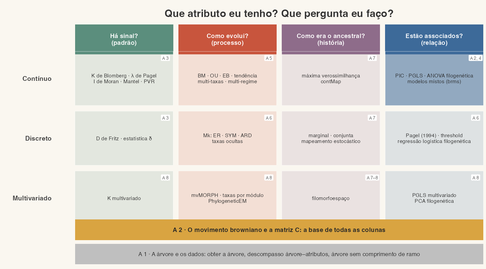

# Plano: reformular Métodos Filogenéticos Comparativos em Quarto/revealjs

Documento orientador da reformulação desta disciplina: não só converter os
`.pptx` em slides Quarto/revealjs, mas reorganizar a sequência das aulas em
torno de um fio condutor. Parte de
`~/GitHub/multidimensionais/WORKFLOW-conversao-qmd.md` e
`~/GitHub/bioestatistica/WORKFLOW-conversao-qmd.md`, que continuam valendo
para tudo o que este plano não mudar.

**Situação** (19/out/2026): o Diogo **aprovou** a estrutura de 8 aulas, o
mapa dos métodos e a nova Aula 2 como aula-modelo (decisões 1–3 da seção
12). As demais decisões (❓) aguardam resposta. Nenhum slide foi escrito.

---

## 1. Ponto de partida

### 1.1 O repositório hoje

Seis aulas (a edição intensiva de 2020, uma semana), cada uma com página,
scripts, dados e walkthroughs (`eval: false`); slides em PDF em `slides/`.
O site é o esqueleto copiado da multidimensionais (commit `f51914a`), ainda
sem tema de slides, `R/`, `_freeze/` nem lista de `render` no `_quarto.yml`.

### 1.2 Fontes: os `.pptx` mais recentes

Há quatro pastas da disciplina no OneDrive (`Aulas/`). A versão mais nova de
cada aula é:

| Aula (2020) | Arquivo | Modificado | Slides | Com imagem | Notas |
|-----:|---------|-----------|------:|-----:|-----:|
| 1 | `2017 - PCM UFSCAR/Aula 1.pptx` (61 MB) | out/2021 | 158 | 126 | 7 |
| 2 | `2017 - PCM UFSCAR/Aula 2.pptx` (92 MB) | out/2021 | 141 | 94 | 3 |
| 3 | `2017 - PCM UFSCAR/Aula 3.pptx` (96 MB) | out/2021 | 61 | 37 | 0 |
| 4 | `2017 - PCM UFSCAR/Aula 4.pptx` (139 MB) | out/2021 | 59 | 45 | 2 |
| 5 | `2017 - PCM UFSCAR/Aula 5.pptx` (6 MB) | ago/2016 | 14 | 8 | 0 |
| 6 | `2017 - PCM UFMS/Aula sexta.pptx` (24 MB) | out/2021 | 39 | 31 | 4 |
| | **Total** | | **472** | **341** | |

- A pasta `2016 - Rio Preto PCM` (adicionada a esta sessão) tem versões de
  2016–2021 das Aulas 1–5, **mais antigas**. `2016 - PCM unifesp` também.
- Os PDFs de `slides/` **não** batem com os `.pptx` de 2021, salvo
  `aula-01.pdf` (158 páginas, mas é a versão de 2019) e `aula-05.pdf`. Por
  isso exportei os `.pptx` para PDF pelo PowerPoint (AppleScript) e montei as
  folhas de contato a partir deles.
- Material de apoio na pasta de Rio Preto: `Likelihood_WoodsHole_19July2016.pdf`,
  `ContinuousModels_ilhabela_2015.pdf` (slides de terceiros, só consulta),
  `PGLS e matriz VCV/`, `Dados_exercicios/`, `workshop-master/`, o vídeo
  `Projection of arithmetic Brownian motion with drift.mp4`.

### 1.3 O mapa mental do Coggle

<https://coggle.it/diagram/WhbkkxE2BAAB0R0m> ("Summary of Phylogenetic
Comparative Methods"), 174 nós. A raiz é uma pergunta, **"What kind of trait
do I have?"**, com três ramos: *Continuous*, *Discrete* e *Multivariate*.
Dentro de cada um, os mesmos tipos de pergunta se repetem: *Inference*
(regressão, correlação), *Evolutionary models* (taxas, regimes),
*Ancestral character estimation* e *Phylogenetic "signal"*. Ao lado da raiz,
ramos práticos: *I have a mismatch between traits and phylogeny*, *I have a
topology without branch lengths*, *Methods for synthesis* (meta-análise e
path analysis filogenéticas) e o aviso *"The Surgeon general warns: before
using any method, read the publication thoroughly"*.

O mapa organiza os métodos por **tipo de atributo × pergunta**; os slides de
hoje os organizam por **método**, na ordem em que foram sendo acrescentados.
A reformulação proposta traz a lógica do mapa para os slides.

---

## 2. Diagnóstico do curso atual

1. **A Aula 1 são três aulas numa** (158 slides): introdução e leitura de
   árvores (1–55), revisão de inferência filogenética com modelos de
   substituição de DNA e softwares (56–88), bases de dados, megafilogenias e
   desenho de estudo (89–158). 126 slides têm imagem, a maioria capturas de
   sites, e vários links estão mortos (`mesquiteproject.wikispaces.com`) ou
   apontam para ferramentas paradas.
2. **O PGLS está espalhado.** Começa no fim da Aula 2 (127–141), depois do
   Mk, e o programa o põe na quarta-feira. Os **contrastes independentes
   (PIC)**, que estão na ementa e no Coggle, aparecem numa única frase
   ("os estimadores dos PIC são equivalentes aos do PGLS").
3. **Os modelos contínuos estão partidos em dois**: BM, OU, EB e tendência na
   Aula 2; OU multi-regime, taxas e convergência na Aula 4, com os modelos
   discretos e o sinal filogenético no meio.
4. **O discreto também está partido**: Mk na Aula 2, estado ancestral
   discreto na Aula 3, correlação de caracteres discretos na Aula 4.
5. **A Aula 5 é um apanhado** (14 slides): forma da árvore, PVR,
   demonstração de gráficos e instruções de R Markdown.
6. **Repetições**: o slide de O'Meara (2012) sobre processos de Markov
   aparece na Aula 1 (77) e na Aula 2 (101); o BM é explicado na Aula 2 e
   retomado na Aula 4 (20–21).
7. **Literatura até ~2018.** Faltam, por exemplo, modelos Mk com taxas
   ocultas, a estatística δ, as críticas recentes ao OU e o PGLS bayesiano.
8. **Memes de internet** (Success Kid ×4, Morpheus, Fry, Globo Repórter) e
   muitas figuras de artigos sem licença aberta.

---

## 3. Desenho pedagógico proposto

### 3.1 Objetivos da disciplina

Ao final, o aluno deve ser capaz de:

1. ler uma filogenia, obter uma árvore para o seu grupo e lidar com o
   descompasso entre a árvore e os dados de atributos;
2. explicar por que espécies não são unidades independentes, usando o
   movimento browniano e a matriz de covariância filogenética **C**;
3. escolher o método a partir de duas perguntas: **que tipo de atributo eu
   tenho** e **que pergunta eu faço** (padrão, processo, história ou
   relação);
4. ajustar e comparar modelos de evolução de atributos contínuos e
   discretos, reconhecendo quando os dados não sustentam o modelo
   (identificabilidade do OU, pseudorreplicação no Pagel 1994, adequação do
   modelo);
5. ajustar uma regressão filogenética (PGLS) e checar seus pressupostos;
6. relatar uma análise comparativa reprodutível (documento Quarto).

### 3.2 Fio condutor: o mapa dos métodos

*(Esboço em `assets/esbocos/mapa_esboco.R`; destaque de exemplo: Aula 2.)*

- **Colunas = as perguntas** do Coggle, em português: *Há sinal?*
  (padrão), *Como evolui?* (processo), *Como era o ancestral?* (história),
  *Estão associados?* (relação). Cada pergunta tem uma cor, a mesma do selo
  no canto dos slides (`.familia .sinal`, `.modelos`, `.ancestral`,
  `.relacao`), como as famílias da multidimensionais.
- **Linhas = o tipo de atributo**: contínuo, discreto, multivariado (a raiz
  do Coggle).
- **Duas faixas de base**, que sustentam todas as colunas: *A árvore e os
  dados* (Aula 1, com os ramos práticos do Coggle) e *O movimento browniano
  e a matriz C* (Aula 2).
- Cada célula tem os métodos (vindos do Coggle) e a aula em que aparecem.
  Toda aula abre com `## Onde estamos` e o mapa com as suas células
  destacadas (`mapa_plot(destaque = ...)`), e fecha com o mapa de novo,
  mostrando o que foi coberto.
- O aviso do Coggle ("leia o artigo do método antes de usá-lo") vira um
  slide fixo no fim de cada aula, com as leituras.

### 3.3 Dois recursos visuais que se repetem

1. **A árvore-guia.** Uma árvore pequena, sempre desenhada do mesmo jeito,
   nos esquemas de todas as aulas: montar **C** e os contrastes (Aula 2),
   transformar a árvore pelo λ (3), o GLS (4), os regimes do OU pintados nos
   ramos (5), o Mk ao longo dos ramos (6), os estados nos nós (7). Proposta:
   a árvore de 7 espécies de Freckleton et al. (2002), que o original já usa
   para montar **C** (Aula 2, slides 36–44), redesenhada em R com os mesmos
   comprimentos de ramo.
2. **Um conjunto de dados que atravessa o curso**: os *Anolis* do
   `phytools` (`anoletree`, `anole.data`): tamanho do corpo e membros
   (contínuos), ecomorfo (discreto, multiestado), morfologia (multivariado) e
   a convergência dos ecomorfos (OU multi-regime), que o original já discute
   (Aula 4, slide 41). Como exemplo brasileiro, os cantos de anuros da
   Bocaina (`canto.csv` e `filogenia_bocaina.txt`, já na pasta da Aula 3),
   de Garey et al. (2018) ✔ `10.1093/biolinnean/bly129` (*Biol. J. Linn.
   Soc.* 125:292–301), com uso autorizado pelo Diogo.

### 3.4 A nova sequência (8 aulas)

| Nova | Título | Pergunta(s) no mapa | Origem no original | Entra de novo |
|---:|---|---|---|---|
| 1 | **A árvore e os dados** | faixa de base | A1 1–55 e 89–158; A5 2–7 (forma da árvore) | ferramentas atuais para obter árvores e bases de atributos (a verificar); revisão de inferência resumida (aprovado) |
| 2 | **O movimento browniano e a matriz C** *(aula-modelo)* | faixa de base + relação (PIC) | A2 3–49; A1 10–14 (recapitulação) | **PIC passo a passo**; simulação do erro tipo I; verossimilhança do BM (→ Aula 5) |
| 3 | **Sinal filogenético** | Há sinal? | A3 24–61; A5 8–10 (PVR) | λ desenhado como transformação da árvore; poder com poucas espécies; estatística δ |
| 4 | **Regressão filogenética (PGLS)** | Estão associados? (contínuo) | A2 127–141; A4 50–58 (`evol.vcv`, `ratematrix`) | ANOVA filogenética; regressão logística filogenética; slide "além do PGLS": regressão logística e de Poisson filogenéticas com `phylolm::phyloglm` (sem `brms`/modelos mistos); incerteza filogenética |
| 5 | **Modelos de evolução contínua: de um a vários regimes** | Como evolui? (contínuo) | A2 50–88; A4 18–49 | identificabilidade do OU e meia-vida filogenética; `l1ou`/PhylogeneticEM; adequação de modelos |
| 6 | **Atributos discretos** | Como evolui? e Estão associados? (discreto) | A2 89–126; A4 1–17; A1 65 e 68–77 (Markov, modelos de DNA) | Mk com taxas ocultas (`corHMM`); pseudorreplicação no método de Pagel |
| 7 | **Estados ancestrais e visualização** | Como era o ancestral? | A3 1–23; A5 11 | incerteza nas estimativas; estado ancestral sob OU × BM |
| 8 | **Atributos multivariados** | linha multivariada | A6 1–39; reaproveitar Procrustes (multidimensionais, Aula 6) e PCA (Aula 4) | K multivariado; PGLS multivariado; dados do `geomorph` (`plethodon`) |

A **avaliação** (A5 12–14: documento dinâmico com pergunta, análise,
resultados e discussão curta) sai dos slides e vai para a página do
programa, com **Quarto** no lugar do R Markdown (aprovado).

### 3.5 Por que essa ordem

- **Aula 2 antes de tudo**: K e λ são definidos em relação ao BM; o λ
  multiplica os elementos fora da diagonal de **C**; o PGLS é um GLS com
  **C**; o OU é um BM com uma força restauradora.
- **Sinal (3) logo depois do BM**: reaproveita **C** na mesma semana do
  conceito, e prepara o "sinal nos resíduos" do PGLS.
- **PGLS (4) antes dos modelos (5)**: é o que a maioria dos alunos vai usar
  na dissertação; os modelos alternativos entram depois como estruturas
  alternativas para **C**.
- **Discretos (6) depois dos contínuos**, numa aula só: o Mk, a matriz **Q**
  e a correlação de Pagel ficam juntos. A matriz **Q** dos modelos de DNA
  (hoje na Aula 1) vira a ponte ("vocês já viram isso").
- **Estados ancestrais (7) depois de 5 e 6**: precisam de um modelo contínuo
  e do Mk. A visualização (`contMap`, `densityMap`, mapeamento estocástico)
  nasce daí.
- **Multivariados (8) por último**: generalizam o PGLS e os modelos.

### 3.6 Cronograma da semana intensiva

A disciplina é ofertada **condensada em uma semana** (Diogo, 19/out/2026).
Cada aula ocupa **um período** (manhã ou tarde), com teoria e prática no
mesmo período: 8 aulas em 10 períodos, sobrando dois. Isso limita o tamanho
de cada deck ao que cabe em meio período de exposição (~50–65 slides).

| Dia | Manhã | Tarde |
|---|---|---|
| Segunda | Aula 1 · A árvore e os dados | Aula 2 · BM e a matriz C |
| Terça | Aula 3 · Sinal filogenético | Aula 4 · PGLS |
| Quarta | Aula 5 · Modelos contínuos | prática livre / dúvidas ❓ |
| Quinta | Aula 6 · Atributos discretos | Aula 7 · Estados ancestrais |
| Sexta | Aula 8 · Multivariados | projetos dos alunos |

Onde ficam os dois períodos livres (aqui, quarta à tarde e sexta à tarde) é
decisão do Diogo ❓.

### 3.7 Leituras prévias e a abertura da Aula 1

Os alunos leem três artigos **antes** da disciplina, e a Aula 1 original foi
preparada supondo que leram:

- Rezende & Diniz-Filho (2012) *Compr. Physiol.* 2:639–674 ✔
  `10.1002/cphy.c100079`;
- O'Meara (2012) *Annu. Rev. Ecol. Evol. Syst.* 43:267–285 ✔
  `10.1146/annurev-ecolsys-110411-160331`;
- Garland, Bennett & Rezende (2005) *J. Exp. Biol.* 208:3015–3035 ✔
  `10.1242/jeb.01745`.

Por isso a Aula 1 original não expõe conceitos nem a origem dos métodos:
passa rápido pela introdução (A1 8–25) e vai para a árvore e os dados.
Aprovado (19/out/2026): **manter a leitura prévia e não transformar a abertura em
aula expositiva**, mas abrir com 3–4 slides que **retomam as leituras** em
vez de supô-las:

1. três perguntas, uma por artigo, respondidas pela turma (ex.: "por que
   espécies não são pontos independentes?"; "que tipos de pergunta os MFC
   respondem?"), com a resposta em fragmento;
2. o **mapa dos métodos** apresentado como a síntese das leituras (O'Meara
   2012 organiza os métodos por pergunta, como o mapa);
3. o problema da não independência em um slide (A1 10–14), que é a base da
   Aula 2;
4. o histórico (A1 15–18) em uma linha do tempo, com links para as obras.

Assim quem leu não ouve de novo o que já sabe, e quem não leu não fica
perdido; os conceitos de que o curso depende ficam ditos uma vez,
explicitamente. As leituras entram na página "Comece aqui", com os links.

---

## 4. Mapeamento original → nova (para nada sumir)

Cada bloco do original tem destino. O inventário slide a slide de cada aula
(`inventarios/aNN.md`) detalha e é conferido contra o deck pronto.

| Original | Slides | Conteúdo | Destino |
|---|---|---|---|
| A1 | 1–7 | capa, avisos, programa, sumário | site (Comece aqui, Programa); sai do deck |
| A1 | 8–25 | o que são MFC, problema do parentesco, histórico, aplicações em evolução cultural | nova 1 (10–14 recapitulados na nova 2) |
| A1 | 26–55 | o que é uma filogenia, conceitos, enraizamento, politomias, tipos de árvore, suporte, Newick e Nexus | nova 1 |
| A1 | 56–77 | critérios de otimização, distância, MP, ML, BI, modelos de substituição | nova 1 resumida (aprovado); Markov e modelos de DNA (65, 68–77) → nova 6 |
| A1 | 78–88 | softwares de inferência (capturas) | nova 1, tabela com links |
| A1 | 89–125 | bases de filogenias, megafilogenias, supermatriz, supertree, NGS, pipelines, árvore à mão, BLADJ | nova 1, resumido em tabelas e links; NGS em um slide |
| A1 | 126–140 | bases de atributos, análises na nuvem | nova 1 |
| A1 | 141–158 | desenho: *shortfalls*, ignorâncias, phyndr, PhyloTargeting, prática | nova 1 |
| A2 | 1–2 | capa, prática do dia anterior | sai |
| A2 | 3–49 | lógica dos modelos, BM, **C**, BM na árvore | **nova 2** (ver `inventarios/a02.md`) |
| A2 | 50–73 | OU, EB, tendência | nova 5 |
| A2 | 74–88 | AIC, seleção e adequação de modelos | nova 5 |
| A2 | 89–126 | Mk, **Q**, *P(t) = e^Qt*, ER/SYM/ARD, multiestado | nova 6 |
| A2 | 127–141 | GLS, OLS, pressupostos, PGLS, PIC = PGLS, diagnóstico | nova 4 |
| A3 | 1–16 | estado ancestral contínuo | nova 7 |
| A3 | 17–23 | estado ancestral discreto, mapeamento estocástico | nova 7 |
| A3 | 24–61 | sinal filogenético (K, λ, Moran, Abouheif, PVR, Mantel, Rao) | nova 3 |
| A4 | 1–17 | correlação de discretos (Pagel 1994, BayesTraits, threshold) | nova 6 |
| A4 | 18–49 | OU destrinchado, paisagens, Brownie, ouch, OUwie, SURFACE, convergência, cautelas | nova 5 |
| A4 | 50–58 | ajuste de matrizes VCV (`evol.vcv`, `ratematrix`) | nova 4 (não estacionaridade) |
| A4 | 59 | meme | sai (meme novo) |
| A5 | 1–7 | formato de filogenias (Colless, γ) | nova 1 |
| A5 | 8–10 | explorando o PVR | nova 3 |
| A5 | 11 | demonstração de gráficos | nova 7 |
| A5 | 12–14 | Markdown e avaliação | página do programa |
| A6 | 1–39 | morfometria geométrica e MFC multivariados | nova 8 |

---

## 5. O que entra de novo (geral)

Todas as referências abaixo serão conferidas no Crossref no lote de cada
aula. As marcadas com ✔ já foram conferidas nesta fase.

- **Contrastes independentes**, passo a passo, na árvore-guia:
  Felsenstein (1985) ✔ `10.1086/284325`; equivalência com o PGLS sob BM:
  Blomberg et al. (2012) ✔ `10.1093/sysbio/syr118`.
- **λ como transformação da árvore** e PGLS com λ estimado junto: Revell
  (2010) ✔ `10.1111/j.2041-210x.2010.00044.x`.
- **Identificabilidade do OU**: Ho & Ané (2014) ✔
  `10.1111/2041-210x.12285`; Cooper et al. (2016) (já na página da Aula 4;
  a conferir).
- **"Rethinking PCMs"**, pseudorreplicação e eventos singulares: Uyeda et
  al. (2018) ✔ `10.1093/sysbio/syy031` (já no original, A2 6 e A4 9).
- Mk com **taxas ocultas** (`corHMM`), **estatística δ** para sinal de
  atributos discretos, **GLM filogenético** (`phylolm::phyloglm`, logística e Poisson),
  **incerteza filogenética**
  (amostra de árvores): referências a buscar e conferir.
- **Ferramentas atuais** para obter árvores e atributos (megafilogenias,
  Open Tree via `rotl`, TimeTree, árvores de anfíbios, bases como a
  AmphiBIO): a levantar e conferir no lote da Aula 1. Nada será citado sem
  conferência.

## 6. O que encolhe na Aula 1 (decidido)

A regra é **não cortar conteúdo**; estas reduções foram aprovadas pelo
Diogo (19/out/2026):

1. ✔ **Revisão de inferência filogenética** (A1 56–88, 33 slides):
   **aprovado resumir** (19/out/2026). O aluno precisa saber de onde vem a
   árvore, como ela é construída, como lê-la e interpretá-la, e as
   limitações. Bloco "De onde vem a árvore" (~10 slides) e os modelos de
   substituição de DNA vão para a Aula 6, como ponte para o Mk.
2. ✔ **Capturas de sites e softwares** (A1 78–88, 91–99, 111–122, 127–140):
   trocar por tabelas com links e uma frase por recurso; manter captura só
   quando a interface importa para a prática.
3. ✔ **NGS** (A1 108–109: plataformas Roche 454, SOLiD, Ion Torrent): datado;
   reduzir a um slide.
4. ✔ **Markdown** (A5 12–13): vira página do site (avaliação em Quarto).
5. ✔ **Bancos de filogenias e de atributos, megafilogenias, pipelines**:
   resumir, com tabelas e links.

## 7. Dados e pacotes

### 7.1 Dados

- **Pacotes** (preferência, como na multidimensionais): `phytools`
  (`anoletree`, `anole.data`, `mammal.tree`/`mammal.data`, `eel.tree`/
  `eel.data`, `sunfish.tree`/`sunfish.data`), `geiger`
  (`geospiza`, `amphibia`, `caudata`), `caper` (`shorebird`), `geomorph`
  (`plethodon`, `plethspecies`), `mvMORPH` (`phyllostomid`).
- **A árvore de Freckleton et al. (2002)** ✔ `10.1086/343873`, lida do
  original: `((sp1:0.18,sp2:0.18):1.06,(sp3:0.02,sp4:0.02):1.22):0.20` e
  `(sp5:1.37,(sp6:0.23,sp7:0.23):1.14):0.07`, ultramétrica (altura 1,44).
- **Simulações** (`ape::rTraitCont`, `phytools::fastBM`, `geiger::sim.char`)
  quando o conceito pede, sempre com semente.
- Cantos de anuros da Bocaina: Garey et al. (2018)
  `10.1093/biolinnean/bly129`, uso autorizado (19/out/2026).

### 7.2 Pacotes

Instalados nesta máquina: `ape` 5.8.1, `phytools` 2.5.2, `geiger` 2.0.12,
`caper`, `nlme`, `phylolm`, `mvMORPH`, `Rphylopars`, `adephylo`, `picante`,
`geomorph`, `RRPP`, `brms`, `ggtree`, `treeio`, `rphylopic`, `magick`.
Não instalados (usados nos scripts de prática): `OUwie`, `l1ou`, `corHMM`,
`phylosignal`, `arbutus`, `rotl`, `phyndr`, `MCMCglmm`, `PVR`,
`PhylogeneticEM`, `surface`, `bayou`.

Pacotes das **figuras dos slides** (aprovados): a base da multidimensionais
(`ggplot2`, `dplyr`, `tidyr`, `purrr`, `tibble`, `patchwork`, `here`,
`knitr`) + `ape`, `phytools`, `geiger`, `nlme`. Árvores desenhadas com uma
função própria em ggplot2 (`R/arvore.R`, a partir das coordenadas do `ape`)
em vez do `ggtree` (Bioconductor): mais controle sobre o estilo da
árvore-guia e um pacote a menos. Sem `brms` nas figuras.

## 8. Figuras: tratamento

**Regra geral do curso (Diogo, 19/out/2026): usar o máximo possível de
imagens CC BY e CC0.** Figura original de artigo ou do Commons com essas
licenças é preferível a redesenhar; redesenho em R fica para o que não tem
licença aberta e para os esquemas.

Mesmas regras da multidimensionais (seções 3.4–3.6 do workflow). Casos
desta disciplina:

| Origem | Exemplos | Tratamento |
|---|---|---|
| Livro de L. Harmon, *Phylogenetic Comparative Methods* (2019) | A2 18–31, 48, 112 | **CC BY-SA 4.0** (Crossref, `10.32942/osf.io/e3xnr`): redesenhar em R; ".ref": "Inspirado em Harmon (2019), cap. N" |
| Slides de J. A. F. Diniz-Filho (crédito no original) | A3 38–55 | ✔ aproveitar a ideia e **redesenhar pesadamente** em R (aprovado); crédito na `.ref`: "Ideia de um slide de J. A. F. Diniz-Filho" |
| Artigos da *Syst. Biol.* | A2 69 (Bokma et al. 2016, CC BY-NC segundo a nota do slide), A2 71, A6 23, 32–33 | conferir a licença; CC BY/BY-NC → original com crédito; demais → redesenhar |
| Artigos da Wiley/*Evolution* | A2 91 (dígitos em Squamata), A6 37 | redesenhar ou citar |
| Retratos de pesquisadores | A1 15–17, A2 9, 52, 65, 68; A4 22, 35 | só domínio público do Commons (Brown, Ornstein, Uhlenbeck, Cope, Depéret, Wright: conferir); fotos recentes saem |
| Memes de internet | A1 7, A2 49/88/95/100/126, A3 19, A4 17 | pinturas brasileiras em domínio público, com legenda própria |
| Capturas de sites | A1 (dezenas) | ver seção 6 |

## 9. Infraestrutura (fase 1)

Copiar da multidimensionais e adaptar:

- `slides/theme.scss`, `slides/_metadata.yml`, `slides/_selo-familia.html`
  (selos das perguntas: `.base`, `.sinal`, `.modelos`, `.ancestral`,
  `.relacao`);
- `R/tema.R` (cores das perguntas em `cores_familia`, `tema_aula()`,
  `OutDec = ","`);
- `R/mapa.R` (`mapa_plot(destaque = ...)`, a partir do esboço);
- **novos**: `R/arvore.R` (árvore-guia, desenho de árvores em ggplot2,
  fenograma, regimes pintados nos ramos), `R/matriz.R` (matrizes desenhadas
  como tabelas, com células destacadas, para **C**, **Q** e *P(t)*),
  `R/bm.R` (simulações de BM, OU, EB e tendência ao longo do tempo);
- `_quarto.yml`: lista de `render` que exclui `README.md`, `CLAUDE.md`,
  `PLANO-conversao-qmd.md` e `inventarios/` (já feito nesta fase), e
  `freeze: auto` com `_freeze/` versionado.
- **Pastas das aulas**: as 6 pastas de hoje seguem a estrutura antiga. As
  páginas e a prática serão reorganizadas nas 8 aulas novas na fase da
  prática, com `aliases` do Quarto para não quebrar os links antigos.

## 10. Aula-modelo: a nova Aula 2

Proposta: **O movimento browniano e a matriz C**. Motivos:

- é a base do mapa: tudo o que vem depois a usa;
- fixa o vocabulário visual do curso (árvore-guia, simulações de BM,
  **C** montada passo a passo, fórmula anotada) que as outras aulas copiam;
- quase tudo pode ser redesenhado em R com dados simulados ou com a árvore
  de Freckleton et al. (2002), sem depender de licenças;
- tem o principal conteúdo novo da reformulação (os contrastes
  independentes).

Inventário slide a slide em `inventarios/a02.md` (slides 1–49 do original
→ ~62 no deck novo, dos quais ~16 novos; o bloco da verossimilhança vai
para a Aula 5).

## 11. Fases e estimativa

| Fase | O que | Observação |
|---|---|---|
| 0. Plano | este arquivo, `CLAUDE.md`, `inventarios/a02.md`, esboço do mapa | **aqui** |
| 1. Infraestrutura | tema, selos, `R/tema.R`, `R/mapa.R`, `R/arvore.R`, `R/matriz.R`, `R/bm.R` | depois da aprovação do plano |
| 2. Aula-modelo | nova Aula 2, duas revisões do Diogo | fixa o padrão |
| 3. Demais aulas | ordem: 3 → 4 → 5 → 6 → 7 → 1 → 8 | inventário slide a slide **antes** de cada deck; a 1 fica para o fim porque depende das decisões da seção 6 |
| 4. Revisões | por URL, slide a slide | |
| 5. Prática | reorganizar scripts e walkthroughs nas 8 aulas; **um desafio por aula** (problema resolvido com código, sozinho) | sessões em paralelo, um PR por aula |
| 6. Site | mapa, Comece aqui, Programa, Roteiros práticos, Glossário | visual da multidimensionais |

Volume: 472 slides no original → 8 decks de ~50–65 slides (um período
cada, com prática).

## 12. Decisões para o Diogo ❓

1. ✔ **Estrutura**: as 8 aulas e a ordem da seção 3.4? (A alternativa é manter
   6 aulas, juntando 6 + 7 e 4 dentro da 2.)
2. ✔ **Fio condutor** (perguntas do mapa aprovadas por enquanto): o mapa *pergunta × tipo de atributo* do esboço? Os
   nomes das quatro perguntas estão bons?
3. ✔ **Aula-modelo**: a nova Aula 2?
4. ✔ **Árvore-guia**: a de Freckleton et al. (2002); ✔ *Anolis* no curso
   todo.
5. ✔ **Bocaina**: autorizado; Garey et al. (2018) `10.1093/biolinnean/bly129`.
6. ✔ **Seção 6**: resumir a inferência, as bases e as ferramentas (tabelas
   e links), NGS reduzido.
7. ✔ **Pacotes** das figuras (seção 7.2), sem `ggtree` e sem `brms`.
   ✔ Aula 4: um slide "além do PGLS" com `phylolm::phyloglm` (logística e
   Poisson). Nada de `brms` nem de modelos mistos: exigem background demais.
8. ✔ **Slides do Diniz-Filho**: aproveitar a ideia e redesenhar pesadamente.
9. ✔ **Avaliação** em Quarto.
10. **Cronograma**: uma aula por período está decidido; onde ficam os dois
    períodos livres (seção 3.6)?
11. ✔ **Atividades**: a atividade de cada aula é o **walkthrough**; além
    dele, **um desafio por aula**: um problema para o aluno resolver
    sozinho, com código (sem atividade extra nos slides).
12. ✔ **Abertura da Aula 1**: retomar as leituras em 3–4 slides (seção 3.7).
