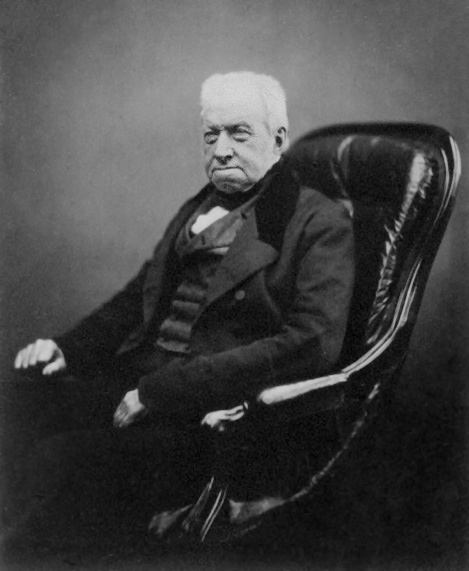
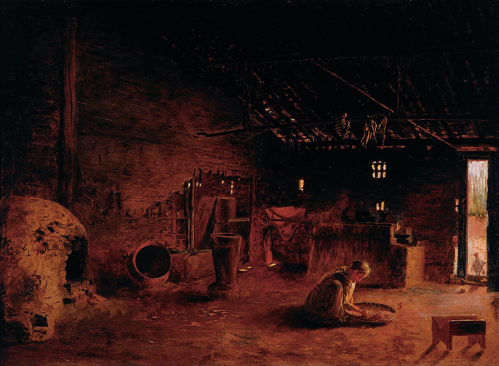

```{r}
#| label: setup
source(here::here("R/mapa.R"))
source(here::here("R/aula02_intro.R"))
source(here::here("R/aula02_bm.R"))
source(here::here("R/aula02_matriz.R"))
source(here::here("R/aula02_arvore.R"))
source(here::here("R/aula02_pic.R"))

num <- function(x, d = 2) format(round(x, d), nsmall = d, decimal.mark = ",")
# dentro de $...$ a vírgula vira pontuação (com espaço): {,} evita isso
numm <- function(x, d = 2) sub(",", "{,}", num(x, d), fixed = TRUE)

tr  <- arvore_guia()
C   <- ape::vcv(tr)
atr <- atributos_guia()
ps  <- pic_passos()
tab_pic <- tabela_pic()
b_pic  <- unname(coef(lm(`Contraste de B` ~ `Contraste de A` - 1, tab_pic)))
b_ols  <- unname(coef(lm(B ~ A, atr))[2])
b_pgls <- unname(coef(nlme::gls(B ~ A, data = as.data.frame(atr),
                                correlation = ape::corBrownian(1, tr, form = ~sp)))[2])
vt     <- var_tempo()
b_vt   <- unname(coef(lm(v ~ t - 1, vt)))
et1    <- erro_tipo1()
X_sim  <- sims_guia()
p10    <- ps[ps$no == 10, ]
```

## Hoje {.muito-grande}

1. Do processo ao padrão
2. O movimento browniano (BM)
3. A matriz de covariância filogenética **C**
4. O BM numa árvore
5. Contrastes independentes

::: {.nota}
Todas as figuras desta aula foram geradas em R, com simulações ou com a
árvore de 7 espécies do exemplo de Freckleton et al. (2002), a
**árvore-guia** do curso. O código está em `R/aula02_*.R`.
:::

## Onde estamos

```{r}
#| fig-height: 5.0
#| fig-alt: "Mapa dos métodos: quatro colunas de perguntas (há sinal, como evolui, como era o ancestral, estão associados) e três linhas de tipos de atributo (contínuo, discreto, multivariado), sobre duas faixas de base. Destacadas: a faixa da Aula 2 (o movimento browniano e a matriz C) e a célula dos atributos contínuos associados (PIC e PGLS)."
mapa_plot(aula = 2)
```

# 1. Do processo ao padrão {.secao}

[O BM e a matriz C]{.familia .base}

## Lembram da Aula 1? Uma correlação entre X e Y...

```{r}
#| fig-alt: "Gráfico de dispersão de 20 espécies com uma reta de regressão crescente entre os atributos X e Y."
fig_recap_clados(1)
```

## ... ou dois clados?

```{r}
#| fig-height: 4
#| fig-alt: "Os mesmos 20 pontos, agora coloridos por clado: os do clado A ficam todos à direita e acima, os do clado B à esquerda e abaixo. Ao lado, a árvore com os dois clados nas mesmas cores."
fig_recap_clados(2)
```

::: {.fragment}
Os dois atributos foram simulados **independentes**. A "correlação" vem só
do parentesco: espécies próximas são mais parecidas, e os graus de
liberdade ficam inflados. Hoje: **por que** espécies próximas se parecem?
:::

## Lógica da formulação dos modelos evolutivos

```{r}
#| fig-alt: "À esquerda, três trajetórias de um fenótipo ao longo do tempo, que partem de um ancestral comum e se separam. À direita, três caixas ligadas por setas para baixo: mecanismos microevolutivos (deriva, seleção, mutação, fluxo gênico), modelos evolutivos, dados interespecíficos."
fig_hansen_martins(1)
```

::: {.ref}
Baseado no esquema de [Hansen & Martins (1996)](https://doi.org/10.1111/j.1558-5646.1996.tb03914.x).
:::

## O caminho inverso não é tão simples...

```{r}
#| fig-height: 3.4
#| fig-alt: "O mesmo esquema, com uma seta vermelha que sobe dos dados interespecíficos até os mecanismos microevolutivos, marcada com um ponto de interrogação."
fig_hansen_martins(2)
```

O caminho dos mecanismos microevolutivos para a variação interespecífica é
conceitual. Inferir esses mesmos mecanismos a partir de padrões
interespecíficos (filogenéticos) é difícil, senão impossível.

::: {.ref}
Ideia de um slide de J. A. F. Diniz-Filho, sobre o esquema de [Hansen & Martins (1996)](https://doi.org/10.1111/j.1558-5646.1996.tb03914.x).
:::

## Padrão, não processo {.muito-grande}

> "Phylogenies can only depict patterns, not underlying processes"

::: {.ref}
[Losos (2011)](https://doi.org/10.1086/660020), *Am. Nat.* 177: 709–727.
:::

::: {.fragment}
Por isso, os métodos filogenéticos comparativos podem ser vistos como uma
**"phylogenetic natural history"**: descrevem padrões que pedem explicação,
e as explicações vêm de outras linhas de evidência.

::: {.ref}
[Uyeda, Zenil-Ferguson & Pennell (2018)](https://doi.org/10.1093/sysbio/syy031), *Syst. Biol.* 67: 1091–1109.
:::
:::

## Modelos de evolução fenotípica {.medio}

- **Movimento browniano (BM)**: muitos métodos usam este modelo; tratabilidade analítica
- **Early burst (EB)**: incorpora a ideia de radiação adaptativa
- **Tendência (*trend*)**: incorpora a ideia de tendência vista em fósseis
- **Ornstein-Uhlenbeck (OU)**: incorpora a ideia de restrições na evolução

```{r}
#| fig-height: 3
#| fig-alt: "Quatro painéis com 25 trajetórias simuladas cada: movimento browniano (leque que se abre aos poucos), early burst (abre rápido no início e depois quase para), tendência (o leque sobe) e Ornstein-Uhlenbeck (as trajetórias sobem até um valor e ficam em torno dele)."
fig_quatro_modelos()
```

::: {.nota}
Hoje, o BM, o modelo nulo. Os outros três ficam para a Aula 5.
:::

# 2. O movimento browniano {.secao}

[O BM e a matriz C]{.familia .base}

## Robert Brown, botânico

:::: {.columns}
::: {.column width="34%"}
{fig-alt="Retrato fotográfico de Robert Brown, idoso, sentado, de casaco escuro." height="380px"}

::: {.ref}
Maull & Polyblank (1855), domínio público, via Wikimedia Commons.
:::
:::
::: {.column width="66%"}
```{r}
#| fig-width: 5.6
#| fig-height: 3.3
#| fig-alt: "Cinco trajetórias de partículas num plano, cada uma de uma cor, em zigue-zague errático a partir de um ponto inicial."
fig_brown()
```
Robert Brown (1773–1858) descreveu o movimento errático de partículas em
suspensão na água, que leva o seu nome.
:::
::::

## Movimento browniano

:::: {.columns}
::: {.column width="55%"}
- Modelo para a evolução de **caracteres contínuos**
  - segue um passeio aleatório (*random walk*)
- O estado do caráter muda continuamente ao longo do tempo
  - **processo estocástico de tempo contínuo**
- Depois de um tempo e de muitas simulações, o estado do caráter segue
  uma **distribuição normal**
:::
::: {.column width="45%"}
```{r}
#| fig-width: 5
#| fig-height: 4
#| fig-alt: "Uma trajetória em zigue-zague de um atributo ao longo do tempo."
fig_passeio()
```
:::
::::

::: {.ref}
O BM entrou na filogenética com [Cavalli-Sforza & Edwards (1967)](https://doi.org/10.1111/j.1558-5646.1967.tb03411.x), que o usaram para modelar a mudança de frequências gênicas ao longo de uma árvore.
:::

## ...mas o que é um processo estocástico de tempo contínuo?

```{r}
#| fig-height: 3.6
#| fig-alt: "Soma de seis dados em dez jogadas sucessivas, ligadas por uma linha, com o valor de cada soma escrito sobre o ponto."
fig_dados(1)
```

Soma dos resultados de **6 dados** (de 6 a 36), jogados 10 vezes.

::: {.ref}
Ideia de um slide de José Hidasi-Neto.
:::

## ...mas o que é um processo estocástico de tempo contínuo?

```{r}
#| fig-height: 3.0
#| fig-alt: "Sessenta séries de dez jogadas sobrepostas, formando uma faixa embaralhada, e ao lado o histograma das somas, com forma de sino centrada em 21."
fig_dados(2)
```

O resultado de cada jogada é **imprevisível**, mas a distribuição de
probabilidade de um conjunto de curvas é **conhecida** (aproximadamente
normal) e permite predizer eventos futuros.

::: {.ref}
Ideia de um slide de José Hidasi-Neto.
:::

## Movimento browniano: os parâmetros {.muito-grande}

Dois parâmetros:

- o **valor inicial**, $z_0$ (o estado na raiz);
- a **taxa de mudança**, $\sigma^2$.

::: {.definicao .fragment}
Cuidado com a notação: em muitos textos (e no original desta aula) o valor
inicial aparece como $\theta$. Neste curso, $\theta$ fica reservado para o
**ótimo** do modelo Ornstein-Uhlenbeck (Aula 5).
:::

## Movimento browniano: o processo de Wiener {.grande}

Três fatos descrevem um BM. Se $W(t)$ é o valor do caráter no tempo $t$:

1. $E[W(t)] = W(0)$: em média, o caráter não sai do lugar;
2. os incrementos (passos sucessivos) são **independentes** ("pouca memória");
3. $W(t) \sim N\big(W(0),\ \sigma^2 t\big)$.

::: {.definicao .fragment}
Traduzindo: o valor do caráter no tempo $t$ segue uma distribuição normal
com **média igual ao valor inicial** $W(0)$ e **variância igual à taxa
vezes o tempo**, $\sigma^2 t$.
:::

## A equação do BM {.muito-grande}

<br>

$$\huge \color{#a15e3f}{dX(t)} \;=\; \color{#527238}{\sigma}\; \color{#1c6e8c}{dB(t)}$$

<br>

::: {.fragment}
[$dX(t)$]{style="color:#a15e3f"}: a quantidade de mudança no caráter $X$ entre o tempo $t$ e $t + dt$
:::

::: {.fragment}
[$\sigma$]{style="color:#527238"}: a raiz da taxa, que dá a escala de cada passo
:::

::: {.fragment}
[$dB(t)$]{style="color:#1c6e8c"}: o passeio aleatório, um sorteio de uma normal com média 0 e variância $dt$
:::

## Simulando o BM

```{r}
#| fig-alt: "Uma trajetória de movimento browniano desenhada até o tempo 33, num eixo de tempo que vai até 100."
fig_bm_traj(1)
```

## Simulando o BM

```{r}
#| fig-alt: "A mesma trajetória, agora até o tempo 66."
fig_bm_traj(2)
```

## Simulando o BM

```{r}
#| fig-alt: "A mesma trajetória completa, até o tempo 100."
fig_bm_traj(3)
```

## Muitas trajetórias: a distribuição no tempo *t*

```{r}
#| fig-alt: "Duzentas trajetórias de BM partindo de zero e abrindo em leque, com a primeira trajetória destacada; ao lado, o histograma dos valores no tempo 100, em forma de sino centrada em zero."
fig_bm_traj(4)
```

::: {.nota}
Cada trajetória é imprevisível; o conjunto tem distribuição normal, com
média no valor inicial.
:::

## Duas linhagens

```{r}
#| fig-alt: "Uma trajetória de BM que, no tempo 50, se divide em duas linhagens (azul e vermelha) que seguem independentes até o tempo 100."
fig_linhagens(2)
```

::: {.nota}
Depois da especiação, cada linhagem segue o seu próprio passeio aleatório,
a partir do **mesmo** valor.
:::

## Duas linhagens, muitas vezes

```{r}
#| fig-alt: "Cento e cinquenta réplicas do mesmo esquema de duas linhagens, em azul e vermelho, e ao lado os histogramas dos valores finais de cada linhagem, sobrepostos."
fig_linhagens(2, muitas = TRUE)
```

## Três linhagens

```{r}
#| fig-alt: "Uma trajetória que se divide no tempo 50 e, de novo, no tempo 75, formando três linhagens."
fig_linhagens(3)
```

## Três linhagens, muitas vezes

```{r}
#| fig-alt: "Cento e cinquenta réplicas do esquema de três linhagens, com os histogramas dos valores finais de cada uma ao lado."
fig_linhagens(3, muitas = TRUE)
```

::: {.nota}
As linhagens que se separaram mais tarde (vermelha e verde) compartilham
mais história, e por isso terminam com valores mais parecidos entre si. É
a ideia da matriz **C**, no bloco 3.
:::

## Por que normal? O teorema do limite central

```{r}
#| fig-height: 4.1
#| fig-alt: "Histograma das somas de 100 passos de mais um ou menos um, em 10 mil réplicas, com a curva normal sobreposta."
fig_tlc()
```

A soma de muitos passos pequenos e independentes tende a uma distribuição
normal, qualquer que seja a distribuição de cada passo.

## A taxa $\sigma^2$

```{r}
#| fig-alt: "Dois painéis com 100 trajetórias de BM cada, com as mesmas sementes: com sigma ao quadrado igual a 0,01 o leque é estreito; com 0,1 é bem mais largo."
fig_sigmas()
```

::: {.ref}
Mesmas sementes nos dois painéis: só muda a taxa. [Butler & King (2004)](https://doi.org/10.1086/426002) ilustram o BM da mesma forma, ao lado do OU.
:::

## A variância cresce com o tempo

```{r}
#| fig-height: 4.1
#| fig-alt: "Variância entre 2000 réplicas de BM em cada tempo, de 0 a 100: os pontos seguem uma reta crescente, sobreposta à reta tracejada variância igual a sigma ao quadrado vezes t."
fig_var_tempo()
```

Com $\sigma^2 = 1$, a inclinação estimada nas simulações é `r num(b_vt)`:
a variância entre linhagens cresce **linearmente** com o tempo.

## Quando a evolução é descrita por BM? {.medio}

```{r}
#| fig-height: 4.0
#| fig-alt: "Quatro painéis de trajetórias simuladas: deriva genética; mudança pontuada aleatória, em degraus; seleção fraca na escala de tempo considerada; seleção que muda de direção ao acaso. Os quatro produzem leques parecidos com o do BM."
fig_quando_bm()
```

Os quatro processos do original (deriva; mudança pontuada aleatória;
seleção fraca em relação à escala de tempo considerada; seleção que muda de
direção aleatoriamente ao longo do tempo) produzem leques como o do BM.

## BM: modelo nulo, não hipótese biológica {.muito-grande}

::: {.definicao}
Processos muito diferentes produzem o mesmo padrão de BM. Ajustar bem um
BM **não** mostra que houve deriva: mostra só que o padrão é compatível com
um passeio aleatório.
:::

<br>

::: {.fragment}
É o mesmo raciocínio de "sinal filogenético é um padrão, não um processo",
na Aula 3.
:::

# 3. A matriz de covariância filogenética **C** {.secao}

[O BM e a matriz C]{.familia .base}

## Como a filogenia influencia a evolução sob BM? {.muito-grande}

O parentesco comum **aumenta** ou **diminui** a similaridade entre espécies
em termos de fenótipo?

<br>

::: {.fragment}
... mas antes, vamos entender o que é uma matriz de distância filogenética
(**patrística**) e uma matriz de **variância-covariância**.
:::

## Matriz de distância patrística

```{r}
#| fig-alt: "Árvore de três espécies: A, num ramo de comprimento 5, e B e C, irmãs, com ramos de 2 a partir de um ramo interno de 3. Ao lado, a matriz de distâncias, só com a diagonal preenchida com zeros."
fig_patristica(1)
```

## Matriz de distância patrística

```{r}
#| fig-alt: "O caminho de A até B pintado na árvore (5 + 3 + 2); na matriz, as distâncias de A a B e de A a C, iguais a 10, em destaque."
fig_patristica(2)
```

$d(A, B) = 5 + 3 + 2 = 10$

## Matriz de distância patrística

```{r}
#| fig-alt: "Os ramos de B e de C pintados; na matriz, a distância entre B e C, igual a 4, em destaque. A matriz completa: 0, 10, 10; 10, 0, 4; 10, 4, 0."
fig_patristica(3)
```

$d(B, C) = 2 + 2 = 4$: a distância soma os ramos **não** compartilhados.

## Matriz de variância-covariância

```{r}
#| fig-height: 4.5
#| fig-alt: "A árvore-guia de 7 espécies com os comprimentos de ramo e, ao lado, uma matriz 7 por 7 com a palavra var na diagonal, em vermelho, e cov fora dela, em azul."
fig_C("simbolica")
```

::: {.ref}
Exemplo de [Freckleton, Harvey & Pagel (2002)](https://doi.org/10.1086/343873), redesenhado: a árvore-guia do curso.
:::

## Matriz de variância-covariância

```{r}
#| fig-height: 4.5
#| fig-alt: "A árvore com o clado das espécies 1 a 4 em azul e o das espécies 5 a 7 em verde; na matriz, os dois blocos correspondentes nas mesmas cores, e zeros entre eles."
fig_C("blocos")
```

Espécies de clados que só se encontram na raiz têm covariância **zero**.

## Matriz de variância-covariância

```{r}
#| fig-height: 4.5
#| fig-alt: "O caminho da raiz até a espécie 1 pintado de ocre (0,20, 1,06 e 0,18); na matriz, a célula da variância da espécie 1, 1,44, em destaque."
fig_C("var1")
```

$\text{var}(sp_1) = 0{,}20 + 1{,}06 + 0{,}18 = 1{,}44$: o caminho inteiro da raiz até a ponta.

## Matriz de variância-covariância

```{r}
#| fig-height: 4.5
#| fig-alt: "O caminho compartilhado pelas espécies 1 e 2 pintado (0,20 e 1,06); na matriz, a covariância entre 1 e 2, 1,26, em destaque."
fig_C("cov12")
```

$\text{cov}(1, 2) = 0{,}20 + 1{,}06 = 1{,}26$: só o caminho **compartilhado**.

## Matriz de variância-covariância

```{r}
#| fig-height: 4.5
#| fig-alt: "Só o ramo de 0,20 pintado, o único compartilhado pelas espécies 1 e 4; na matriz, a covariância entre 1 e 4, 0,20, em destaque."
fig_C("cov14")
```

$\text{cov}(1, 4) = 0{,}20$

## Matriz de variância-covariância

```{r}
#| fig-height: 4.5
#| fig-alt: "O caminho compartilhado pelas espécies 3 e 4 pintado (0,20 e 1,22); na matriz, a covariância entre 3 e 4, 1,42, em destaque."
fig_C("cov34")
```

$\text{cov}(3, 4) = 0{,}20 + 1{,}22 = 1{,}42$

## Matriz de variância-covariância

```{r}
#| fig-height: 3.4
#| fig-alt: "A árvore-guia e a matriz C completa."
fig_C("completa", base_mat = 4.3)
```

::: {.definicao}
Espécies 3 e 4 são mais parecidas entre si (maior covariância em termos de
fenótipo) do que as espécies 1 e 2, porque compartilham maior **proporção
de história evolutiva comum** (`r num(C[3, 4])` contra `r num(C[1, 2])`).
:::

## A regra geral {.grande}

::: {.definicao}
$C_{ij}$ = comprimento do caminho **compartilhado** da raiz até o ancestral
comum mais recente de $i$ e $j$. Na diagonal, $C_{ii}$ = distância da raiz
até a ponta $i$.
:::

<br>

Sob BM com taxa $\sigma^2$, os valores das pontas $\mathbf{X}$ seguem uma
normal multivariada:

$$\mathbf{X} \sim N\big(z_0 \mathbf{1},\ \sigma^2 \mathbf{C}\big)$$

::: {.nota .fragment}
Em R: `ape::vcv(arvore)`. A distância patrística é o complemento:
$d_{ij} = C_{ii} + C_{jj} - 2C_{ij}$.
:::

## A mesma filogenia pode gerar diferentes matrizes

```{r}
#| fig-height: 4.2
#| fig-alt: "Três mapas de calor 7 por 7 da mesma árvore: sob BM, os blocos dos clados aparecem nítidos; com lambda igual a 0,5, as covariâncias fora da diagonal ficam pela metade; sob OU com alfa igual a 2, só as espécies irmãs mantêm covariância alta."
fig_tres_matrizes()
```

Cada **modelo evolutivo** transforma a árvore numa matriz diferente: é
assim que o λ (Aula 3) e o OU (Aula 5) entram nos métodos.

# 4. O BM numa árvore {.secao}

[O BM e a matriz C]{.familia .base}

## Estrela × árvore {.medio}

```{r}
#| fig-height: 4.5
#| fig-alt: "À esquerda, a filogenia em estrela, com as 7 espécies saindo da raiz, e embaixo o fenograma do BM: as 7 trajetórias se separam desde o início. À direita, a árvore-guia e o fenograma: as trajetórias das espécies irmãs seguem juntas até se separarem perto do fim."
fig_estrela_vs_arvore()
```

Na estrela, assumimos que as espécies são **independentes**; na árvore, as
espécies têm uma **estrutura de parentesco**.

## O parentesco cria covariação

```{r}
#| fig-height: 3.8
#| fig-alt: "Quatro gráficos de dispersão com 1000 réplicas de BM na árvore-guia: espécies 3 e 4 quase sobre uma reta; espécies 1 e 2 numa nuvem alongada; espécies 1 e 3 numa nuvem quase redonda; espécies 1 e 5 numa nuvem redonda."
fig_pares()
```

Em `r nrow(X_sim)` réplicas de BM na árvore-guia, a correlação entre duas
espécies acompanha o caminho que elas compartilham.

## A covariância das réplicas é σ²**C**

```{r}
#| fig-height: 4.4
#| fig-alt: "Lado a lado, a matriz C calculada da árvore e a matriz de covariância das 1000 réplicas simuladas: os números são quase iguais."
fig_cov_sim()
```

Com $\sigma^2 = 1$, a covariância entre as pontas, estimada das
simulações, reproduz **C**.

## Por que isso importa: o erro tipo I

```{r}
#| fig-height: 3.4
#| fig-alt: "À esquerda, uma árvore com dois clados de 10 espécies, de ramos internos longos. À direita, barras com a proporção de simulações com p menor que 0,05: alta com OLS e perto de 5 por cento com PGLS; linha tracejada em 5 por cento."
fig_erro_tipo1(et1)
```

Dois atributos **independentes**, simulados por BM 1000 vezes numa árvore
de dois clados: a regressão comum acusa relação em `r num(100 * et1$taxa[1], 1)` %
das vezes; com **C** no modelo (PGLS), em `r num(100 * et1$taxa[2], 1)` %.

::: {.ref}
É o "pior caso" de [Felsenstein (1985)](https://doi.org/10.1086/284325). O PGLS é o tema da Aula 4.
:::

# 5. Contrastes independentes {.secao}

[Estão associados?]{.familia .relacao}

## A ideia de Felsenstein (1985)

:::: {.columns}
::: {.column width="58%"}
```{r}
#| fig-width: 6
#| fig-height: 4.6
#| fig-alt: "A árvore-guia com o valor do atributo A ao lado de cada espécie: 2,51; 2,80; 2,23; 2,32; 1,64; 1,18; 0,58."
fig_pic(0)
```
:::
::: {.column width="42%"}
As espécies não são independentes, mas as **diferenças entre espécies
irmãs** são: cada uma surgiu depois da separação, num ramo próprio.

::: {.fragment}
Com $n$ espécies, há $n - 1$ contrastes independentes, um por nó.
:::
:::
::::

::: {.ref}
[Felsenstein (1985)](https://doi.org/10.1086/284325), *Am. Nat.* 125: 1–15. Atributo A do exemplo de Freckleton et al. (2002).
:::

## Passo 1: o contraste entre duas irmãs

:::: {.columns}
::: {.column width="58%"}
```{r}
#| fig-width: 6
#| fig-height: 4.6
#| fig-alt: "A árvore-guia com os ramos das espécies 1 e 2, de comprimento 0,18 cada, pintados de ocre."
fig_pic(1)
```
:::
::: {.column width="42%"}
A diferença, padronizada pelo desvio padrão esperado sob BM:

$$c = \frac{x_1 - x_2}{\sqrt{v_1 + v_2}}$$

::: {.fragment}
$$c = \frac{2{,}51 - 2{,}80}{\sqrt{0{,}18 + 0{,}18}} = `r numm(p10$contraste)`$$
:::
:::
::::

## Passo 2: o valor do nó

:::: {.columns}
::: {.column width="58%"}
```{r}
#| fig-width: 6
#| fig-height: 4.6
#| fig-alt: "A mesma árvore, agora com o valor estimado do nó 10, 2,66, numa etiqueta sobre o nó."
fig_pic(2)
```
:::
::: {.column width="42%"}
Média dos filhos, ponderada pelo inverso dos ramos:

$$x_k = \frac{x_1/v_1 + x_2/v_2}{1/v_1 + 1/v_2}$$

::: {.fragment}
Com ramos iguais, é a média simples: $x_{10} = `r numm(p10$valor_no)`$.
:::
:::
::::

## Passo 3: alongar o ramo do nó

:::: {.columns}
::: {.column width="58%"}
```{r}
#| fig-width: 6
#| fig-height: 4.6
#| fig-alt: "O ramo que leva ao nó 10 pintado de vermelho, com a conta 1,06 mais 0,09 igual a 1,15 escrita embaixo."
fig_pic(3)
```
:::
::: {.column width="42%"}
O valor do nó é uma **estimativa**, com incerteza. Ela entra como um
acréscimo ao ramo acima do nó:

$$v_k \leftarrow v_k + \frac{v_1 v_2}{v_1 + v_2}$$

::: {.fragment}
$1{,}06 + \frac{0{,}18 \cdot 0{,}18}{0{,}36} = `r numm(1.06 + p10$extra)`$
:::
:::
::::

## Repetir até a raiz

:::: {.columns}
::: {.column width="58%"}
```{r}
#| fig-width: 6
#| fig-height: 4.6
#| fig-alt: "A árvore-guia com os valores estimados em todos os seis nós; na raiz, 1,83."
fig_pic(4)
```
:::
::: {.column width="42%"}
Nó a nó, das pontas para a raiz: `r nrow(ps)` contrastes para 7 espécies.

::: {.fragment}
O valor da raiz (`r num(ps$valor_no[ps$no == 8])`) é a estimativa de
máxima verossimilhança do estado ancestral sob BM: voltamos a ele na
Aula 7.
:::
:::
::::

## Os contrastes de A e de B {.tabela-grande .grande}

```{r}
tab_pic |>
  dplyr::mutate(dplyr::across(3:4, \(z) num(z, 3))) |>
  knitr::kable(align = c("c", "l", "r", "r"))
```

::: {.nota}
Calculados com `pic_passos()` e conferidos com `ape::pic()`.
:::

## Regressão dos contrastes pela origem

:::: {.columns}
::: {.column width="58%"}
```{r}
#| fig-width: 6
#| fig-height: 4.6
#| fig-alt: "Os seis contrastes de B contra os de A, com a reta de regressão passando pela origem."
fig_pic_reg()
```
:::
::: {.column width="42%"}
Regressão **sem intercepto**: o sinal de cada contraste depende só da ordem
em que as irmãs foram subtraídas, e trocar a ordem tem de dar a mesma
reta.

::: {.fragment}
Inclinação: `r num(b_pic, 3)`.
:::
:::
::::

## Espécies × contrastes

```{r}
#| fig-height: 4.1
#| fig-alt: "À esquerda, B contra A nas 7 espécies, com a reta de OLS quase plana, inclinação 0,13. À direita, os contrastes, com inclinação 1,40."
fig_bruto_vs_pic()
```

Mesmos dados, conclusões diferentes: com as espécies tratadas como
independentes, a inclinação é `r num(b_ols)`; com os contrastes, `r num(b_pic)`.

## PIC = PGLS sob BM {.grande}

```{r}
#| echo: true
#| eval: false
pic_A <- ape::pic(A, arvore)
pic_B <- ape::pic(B, arvore)
lm(pic_B ~ pic_A - 1)                       # contrastes

nlme::gls(B ~ A, data = dados,              # PGLS com C
          correlation = ape::corBrownian(1, arvore, form = ~sp))
```

::: {.tabela-grande}

| | Inclinação |
|---|---:|
| Contrastes (pela origem) | `r num(b_pic, 4)` |
| PGLS com `corBrownian` | `r num(b_pgls, 4)` |

:::

::: {.ref}
A equivalência é exata sob BM: [Blomberg, Lefevre, Wells & Waterhouse (2012)](https://doi.org/10.1093/sysbio/syr118), *Syst. Biol.* 61: 382–391.
:::

## Pressupostos dos contrastes

:::: {.columns}
::: {.column width="50%"}
- Topologia e comprimentos de ramo **corretos**
- Evolução por **BM** (os ramos são a variância esperada)
- Diagnóstico: o |contraste| não deve depender do seu desvio padrão
:::
::: {.column width="50%"}
```{r}
#| fig-width: 5.4
#| fig-height: 4.4
#| fig-alt: "Valor absoluto dos contrastes de A contra o desvio padrão de cada contraste, sem tendência clara."
fig_pic_diag()
```
:::
::::

::: {.ref}
O diagnóstico vem de [Garland, Harvey & Ives (1992)](https://doi.org/10.2307/2992503), *Syst. Biol.* 41.
:::

# Para fechar {.secao}

## Onde estamos

```{r}
#| fig-height: 5.0
#| fig-alt: "O mapa dos métodos de novo, com a faixa da Aula 2 e a célula PIC e PGLS destacadas: a base de tudo o que vem a seguir."
mapa_plot(aula = 2)
```

## Leituras {.muito-grande}

- [Harmon (2019), cap. 3](https://lukejharmon.github.io/pcm/chapter3_bmintro/) e [cap. 4](https://lukejharmon.github.io/pcm/chapter4_fitbm/): o movimento browniano e o seu ajuste
- [Felsenstein (1985)](https://doi.org/10.1086/284325): os contrastes independentes
- [Freckleton, Harvey & Pagel (2002)](https://doi.org/10.1086/343873): a matriz **C**, o λ e o exemplo da árvore-guia
- [Blomberg et al. (2012)](https://doi.org/10.1093/sysbio/syr118): PIC e PGLS são equivalentes

::: {.definicao}
Antes de usar qualquer método, leia o artigo que o propôs. Não fazer isso
pode causar a rejeição do seu manuscrito.
:::

## Agora é com vocês

::: {.meme}
{fig-alt="Pintura Cozinha caipira, de Almeida Júnior: interior escuro de uma cozinha de chão de terra, com um forno de barro à esquerda; uma mulher, agachada, peneira grãos num balaio. Legenda: teoria peneirada; agora é mão na massa." height="560px"}

[Teoria peneirada]{.meme-topo} [Agora é mão na massa]{.meme-base}
:::

::: {.ref}
Almeida Júnior, *Cozinha caipira* (1895), Pinacoteca do Estado de São Paulo, domínio público, via Wikimedia Commons. Prática: o walkthrough da Aula 2 e o desafio.
:::
