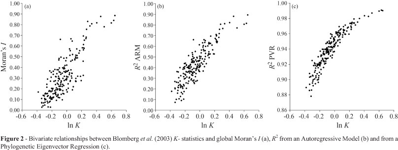
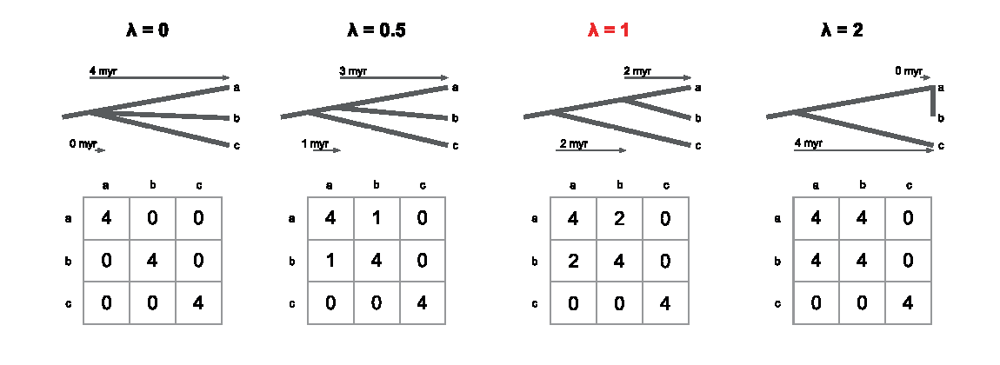
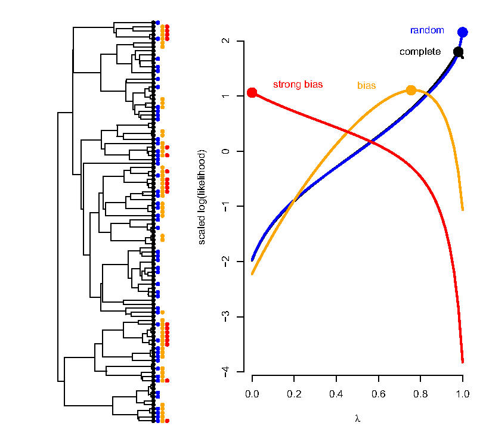
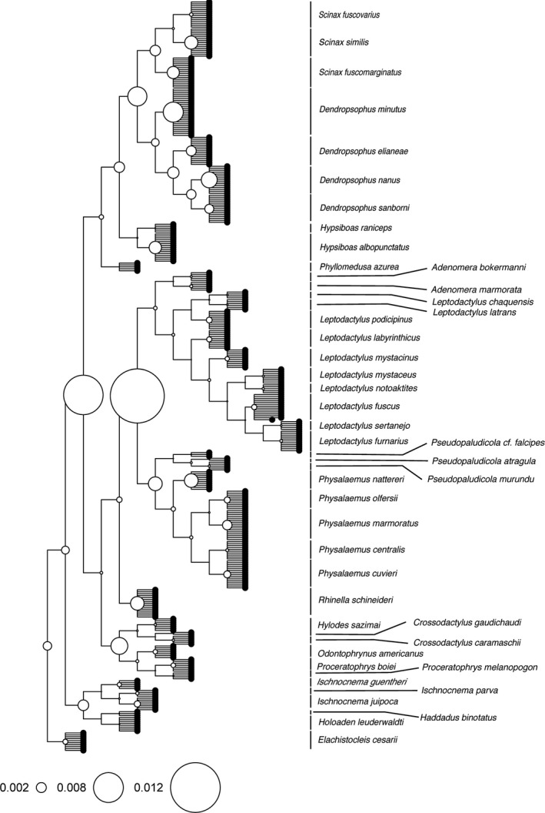

```{r}
#| label: setup
source(here::here("R/mapa.R"))
source(here::here("R/aula03_sinal.R"))
source(here::here("R/aula03_autocor.R"))
source(here::here("R/aula03_pvr.R"))
source(here::here("R/aula03_discretos.R"))

# dentro de $...$ a vírgula vira pontuação (com espaço): {,} evita isso
numm <- function(x, d = 2) sub(",", "{,}", num(x, d), fixed = TRUE)

guia <- arvore_guia(); atr <- atributos_guia(); xa <- setNames(atr$A, atr$sp)
kp   <- k_passos(guia, xa)
an   <- anolis()
sm   <- sim_sinal_modelos()
med  <- sm |> dplyr::group_by(modelo) |> dplyr::summarise(K = median(K), lambda = median(lambda))
kn   <- k_nulo()
pw   <- poder_sinal()
pl   <- phytools::phylosig(an$arvore, an$svl, method = "lambda", test = TRUE)
Dg   <- ape::cophenetic.phylo(guia)[names(xa), names(xa)]; Wg <- 1 / Dg; diag(Wg) <- 0
I_guia  <- moran_I(xa, Wg); I_guia_ape <- ape::Moran.I(xa, Wg)$observed
ab   <- abouheif_dados()
mg   <- mantel_guia()
pvr  <- pvr_passos(guia, xa, k = 2)
boc  <- pvr_bocaina()
dd   <- d_anolis()
```

## Hoje {.muito-grande}

1. O que é "sinal" filogenético
2. Medidas para atributos contínuos: um mapa
3. K de Blomberg
4. λ de Pagel
5. Autocorrelação: I de Moran e C de Abouheif
6. Mantel e distogramas
7. PVR: componentes filogenético e específico
8. Atributos categóricos: D, decomposição de Rao e δ

## Onde estamos

```{r}
#| fig-height: 5.0
#| fig-alt: "Mapa dos métodos com a coluna Há sinal? destacada nas linhas de atributos contínuos e discretos."
mapa_plot(aula = 3)
```

# 1. O que é "sinal" filogenético {.secao}

[Há sinal?]{.familia .sinal}

## Definição

::: {.definicao}
A tendência de espécies aparentadas serem mais parecidas entre si do que
com espécies tomadas ao acaso na filogenia.
:::

```{r}
#| fig-height: 2.8
#| fig-alt: "A árvore-guia duas vezes. À esquerda, barras de um atributo simulado por BM: as espécies irmãs têm barras parecidas. À direita, o mesmo atributo embaralhado entre as pontas: irmãs com barras bem diferentes."
fig_definicao()
```

Mesmos valores, mesma árvore: o sinal está na **associação** entre os
valores e o parentesco.

::: {.ref}
[Blomberg & Garland (2002)](https://doi.org/10.1046/j.1420-9101.2002.00472.x), *J. Evol. Biol.* 15: 899–910.
:::

## "Sinal" filogenético: dois sentidos

```{r}
#| fig-height: 3.9
#| fig-alt: "Uma caixa Sinal filogenético com setas para duas caixas: inferência filogenética, habilidade de um caráter de reconstruir a história das espécies; e métodos comparativos, ecofilogenética e macroevolução, espécies aparentadas são mais parecidas."
fig_dois_sentidos()
```

Nesta disciplina, o segundo sentido.

## Vários modelos evolutivos geram "sinal"

```{r}
#| fig-height: 4.1
#| fig-alt: "Distribuições de K e de lambda em 100 simulações na árvore dos Anolis sob quatro modelos. BM: K perto de 1 e lambda perto de 1. OU com alfa 2: valores intermediários. OU com alfa 10: K e lambda baixos. Early burst: K muito acima de 1 e lambda perto de 1."
fig_sinal_modelos(sm)
```

::: {.ref}
`r nrow(sm) / 4` simulações por modelo na árvore dos *Anolis* (altura 1). Inspirado em [Revell, Harmon & Collar (2008)](https://doi.org/10.1080/10635150802302427).
:::

## "Sinal" filogenético é um padrão, não um processo {.muito-grande}

::: {.definicao}
O mesmo valor de K ou de λ pode vir de processos diferentes, e processos
diferentes podem dar o mesmo valor.
:::

<br>

::: {.fragment}
É o mesmo raciocínio do BM como modelo nulo, na Aula 2. E é por isso que
"sinal" vai entre aspas: é um **padrão estatístico** dos dados numa árvore,
não uma propriedade do atributo.
:::

## "Sinal" não é sinônimo de restrição

```{r}
#| fig-height: 3.9
#| fig-alt: "As mesmas distribuições, com BM e OU de alfa 10 destacados e os outros esmaecidos."
fig_sinal_modelos(sm, destaque = c("BM", "OU, α = 10"))
```

Um modelo sem restrição (BM) gera sinal alto (K mediano
`r num(med$K[med$modelo == "BM"])`); um com restrição forte (OU, α = 10) gera
sinal baixo (K mediano `r num(med$K[med$modelo == "OU, α = 10"])`).

# 2. Medidas para atributos contínuos: um mapa {.secao}

[Há sinal?]{.familia .sinal}

## As medidas desta aula {.tabela-grande .medio}

| Medida | Atributo | O que mede | Em R |
|---|---|---|---|
| K de Blomberg | contínuo | variância observada / esperada sob BM | `phylosig` (phytools) |
| λ de Pagel | contínuo | transformação da árvore | `phylosig` (phytools) |
| I de Moran, C de Abouheif | contínuo | autocorrelação | `Moran.I` (ape) |
| Mantel, distograma | contínuo(s) | correlação entre distâncias | `mantel` (vegan) |
| R² do PVR | contínuo | regressão nos autovetores | `lm` |
| D de Fritz & Purvis | binário | agrupamento na árvore | `phylo.d` (caper) |
| Decomposição de Rao | categórico | onde está a diversidade | pacote adiv |

## As medidas concordam?

{fig-alt="Figura 2 de Diniz-Filho et al. (2012): três gráficos de dispersão do logaritmo do K de Blomberg contra o I de Moran, o R² de um modelo autorregressivo e o R² do PVR, em simulações de BM; as três relações são positivas e fortes." width="100%"}

As medidas são correlacionadas sob BM, mas não são intercambiáveis.

::: {.ref}
Fig. 2 de [Diniz-Filho, Santos, Rangel & Bini (2012)](https://doi.org/10.1590/s1415-47572012005000053), *Genet. Mol. Biol.* 35: 673–679, CC BY-NC 4.0. Comparação mais ampla: [Münkemüller et al. (2012)](https://doi.org/10.1111/j.2041-210x.2012.00196.x).
:::

# 3. K de Blomberg {.secao}

[Há sinal?]{.familia .sinal}

## K de Blomberg {.muito-grande}

- Razão entre o erro quadrático médio das espécies em torno da média
  filogenética (MSE₀) e o erro calculado com a matriz **C** (MSE)
- Se a filogenia prediz a semelhança, o MSE é pequeno e MSE₀/MSE é grande
- Essa razão é dividida pelo **esperado sob BM**: por isso o K pode ser
  comparado entre árvores de tamanhos e formatos diferentes

::: {.ref}
[Blomberg, Garland & Ives (2003)](https://doi.org/10.1554/0014-3820(2003)057[0717:tfpsic]2.0.co;2), *Evolution* 57: 717–745.
:::

## A fórmula do K

<br>

$$\Large K = \frac{\color{#1c6e8c}{\left(\dfrac{\mathrm{MSE}_0}{\mathrm{MSE}}\right)_{\text{observado}}}}{\color{#a15e3f}{\dfrac{1}{n-1}\left(\mathrm{tr}\,\mathbf{C} - \dfrac{n}{\sum\sum \mathbf{C}^{-1}}\right)}}$$

<br>

::: {.fragment}
[Numerador]{style="color:#1c6e8c"}: quanto a filogenia explica dos dados.
[Denominador]{style="color:#a15e3f"}: quanto ela explicaria se o atributo
evoluísse por BM nesta árvore.
:::

## K passo a passo na árvore-guia {.grande .tabela-grande}

Atributo A das 7 espécies (Aula 2):

| Passo | Valor |
|---|---:|
| Média filogenética, $\hat a$ | `r num(kp$a, 3)` |
| MSE₀ (em torno de $\hat a$, sem a árvore) | `r num(kp$mse0, 3)` |
| MSE (com **C**) | `r num(kp$mse, 3)` |
| Razão observada, MSE₀/MSE | `r num(kp$obs, 3)` |
| Razão esperada sob BM | `r num(kp$esp, 3)` |
| **K** | **`r num(kp$K, 3)`** |

::: {.nota}
Conferido com `phytools::phylosig(arvore, A, method = "K")`.
:::

## Como ler o K

```{r}
#| fig-height: 3.8
#| fig-alt: "Uma régua do K: K igual a 0, sem sinal; K igual a 1, o esperado sob BM; K maior que 1, parentes mais parecidos do que o esperado sob BM. Acima da parte entre 0 e 1, a nota: K menor que 1, menos parecidos que o esperado, por homoplasia, adaptação não correlacionada com a filogenia ou erro de medida."
fig_regua_k()
```

::: {.ref}
Paráfrase de [Blomberg et al. (2003)](https://doi.org/10.1554/0014-3820(2003)057[0717:tfpsic]2.0.co;2).
:::

## O K do tamanho do corpo dos *Anolis*

```{r}
#| fig-height: 4.1
#| fig-alt: "Histograma dos valores de K com as pontas embaralhadas, concentrados entre 0,1 e 0,6, e uma linha vertical vermelha muito à direita, no K observado de 1,70."
fig_k_nulo(kn)
```

SVL de `r ape::Ntip(an$arvore)` espécies: K = `r num(kn$obs)`, maior que
todos os `r length(kn$nulo)` valores com as pontas embaralhadas.

## Quantas espécies são necessárias?

```{r}
#| fig-height: 4.1
#| fig-alt: "Proporção de testes significativos de K e de lambda quando o atributo evoluiu de fato por BM, contra o número de espécies: com 10 espécies, cerca de 65 por cento para K e 57 por cento para lambda; com 50 ou mais, 100 por cento."
fig_poder(pw)
```

Com `r pw$n[1]` espécies, o teste do K detecta o sinal de um BM verdadeiro
em `r num(100 * pw$K[1], 0)` % das vezes; o do λ, em `r num(100 * pw$lambda[1], 0)` %.

# 4. λ de Pagel {.secao}

[Há sinal?]{.familia .sinal}

## λ de Pagel

```{r}
#| fig-alt: "Árvore de cinco espécies com os comprimentos de ramo e a sua matriz C: variâncias 10 na diagonal; covariâncias 8 entre sp1 e sp2, 3 entre sp3 e as espécies 4 e 5, e 9 entre sp4 e sp5."
fig_lambda(1)
```

::: {.ref}
[Pagel (1999)](https://doi.org/10.1038/44766), *Nature* 401: 877–884.
:::

## O λ multiplica as covariâncias

```{r}
#| fig-alt: "A mesma matriz, com as covariâncias destacadas e escritas como lambda vezes 8, lambda vezes 3 e lambda vezes 9."
fig_lambda(1, marcar = TRUE)
```

A diagonal não muda; o que muda é quanto as espécies compartilham.

## λ = 0,5

```{r}
#| fig-alt: "Com lambda igual a 0,5, os ramos internos da árvore encurtam pela metade e as pontas se alongam; na matriz, as covariâncias caem para 4; 1,5 e 4,5."
fig_lambda(.5)
```

::: {.fragment}
$0{,}5 \times 8 = 4$; $\;0{,}5 \times 3 = 1{,}5$; $\;0{,}5 \times 9 = 4{,}5$
:::

## λ = 0,05

```{r}
#| fig-alt: "Com lambda igual a 0,05, a árvore vira quase uma estrela; as covariâncias caem para 0,4; 0,15 e 0,45."
fig_lambda(.05)
```

λ = 1: a árvore como ela é (BM). λ = 0: uma **estrela** (espécies
independentes).

## λ multiplica a matriz, não os ramos

{fig-alt="Figura 1 de Pearse et al. (2025): uma árvore de três espécies e a sua matriz C sob lambda igual a 0, 0,5, 1 e 2. Com lambda 0, estrela, covariâncias zero; com 0,5, covariância 1; com 1, a árvore original, covariância 2; com 2, a covariância chega a 4, igual à variância, e o ramo interno ocupa toda a altura da árvore." width="100%"}

O λ escala os elementos **fora da diagonal** de **C**. Pode passar de 1, mas
só até a covariância igualar a variância (aqui, λ = 2): além disso, **C**
deixa de ser uma matriz de covariância válida. É por isso que o λ de 1,013
da Aula 4 é possível.

::: {.ref}
Fig. 1 de [Pearse, Davies & Wolkovich (2025)](https://doi.org/10.1111/geb.70012), *Glob. Ecol. Biogeogr.* 34: e70012, CC BY 4.0.
:::

## O λ é estimado por máxima verossimilhança

```{r}
#| fig-height: 3.7
#| fig-alt: "Log-verossimilhança do SVL dos Anolis em função de lambda: sobe continuamente de lambda igual a 0 até o máximo em lambda igual a 1."
fig_perfil_lambda()
```

SVL dos *Anolis*: λ = `r num(pl$lambda)`; o teste da razão de
verossimilhança contra λ = 0 dá *p* = `r format(signif(pl$P, 2), decimal.mark = ",")`.
Relate o **intervalo**, não só a estimativa: o perfil quase sempre é largo.

::: {.ref}
O intervalo de confiança pelo perfil segue a recomendação de [Pearse et al. (2025)](https://doi.org/10.1111/geb.70012).
:::

## A amostragem de espécies enviesa o λ

{fig-alt="Figura 3 de Pearse et al. (2025): uma filogenia simulada com as espécies amostradas de quatro maneiras e os perfis de verossimilhança de lambda: com amostragem completa ou aleatória, a estimativa fica perto de 1, o valor verdadeiro; com amostragem enviesada pelo próprio atributo, a estimativa cai, e com viés forte vai a 0." height="420px"}

Quando as espécies amostradas dependem do próprio atributo (um filtro
ambiental, por exemplo), o λ sai enviesado: não compare λ entre
assembleias diferentes.

::: {.ref}
Fig. 3 de [Pearse et al. (2025)](https://doi.org/10.1111/geb.70012), CC BY 4.0.
:::

## Cinco pontos sobre o λ {.grande}

1. Num atributo, o λ mede o quanto a evolução se ajusta ao BM, **não** a
   taxa de evolução
2. Estimado em clados amostrados de forma incompleta, supõe amostragem
   aleatória de espécies, o que quase nunca vale em dados ecológicos
3. λ alto é necessário, mas não suficiente, para imputar dados pela
   filogenia
4. No PGLS, o λ é estimado nos **resíduos** e não mede o sinal dos atributos
5. Modelos hierárquicos dão medidas parecidas (como o h²), mas não iguais

::: {.ref}
Paráfrase de [Pearse, Davies & Wolkovich (2025)](https://doi.org/10.1111/geb.70012), *Glob. Ecol. Biogeogr.* 34: e70012.
:::

## K e λ não medem a mesma coisa {.grande .tabela-grande}

Simulações sob OU com força de restrição crescente (α), 200 réplicas:

| α do OU | 0 | 2 | 4 | 6 | 8 | 10 |
|---|---:|---:|---:|---:|---:|---:|
| K médio | 0,994 | 0,571 | 0,392 | 0,301 | 0,245 | 0,212 |
| λ médio | 1,000 | 0,999 | 0,999 | 0,994 | 0,976 | 0,941 |

O K cai à medida que o OU apaga a estrutura da árvore; o λ, que é um
parâmetro de transformação da árvore, continua perto de 1 nessas
simulações.

::: {.ref}
Adaptado da Tabela 2 de [Diniz-Filho et al. (2012)](https://doi.org/10.1590/s1415-47572012005000053), *Genet. Mol. Biol.* Nas simulações desta aula (bloco 1), com outra árvore, o λ caiu mais: o resultado depende da árvore.
:::

# 5. Autocorrelação filogenética: I de Moran e C de Abouheif {.secao}

[Há sinal?]{.familia .sinal}

## I de Moran {.grande}

<br>

$$\Large I = \frac{\color{#1c6e8c}{n}}{\color{#96661f}{W}} \cdot \frac{\sum_i \sum_j \color{#527238}{w_{ij}}\, \color{#a15e3f}{z_i z_j}}{\sum_i z_i^2}$$

::: {.fragment}
[$n$]{style="color:#1c6e8c"}: número de espécies ·
[$w_{ij}$]{style="color:#527238"}: peso entre $i$ e $j$ (o inverso da
distância filogenética) · [$W$]{style="color:#96661f"}: soma dos pesos ·
[$z_i z_j$]{style="color:#a15e3f"}: o atributo nas duas espécies, centrado
na média
:::

::: {.ref}
Ideia de um slide de J. A. F. Diniz-Filho. Em dados comparativos: [Gittleman & Kot (1990)](https://doi.org/10.2307/2992183).
:::

## A matriz de pesos W na árvore-guia

```{r}
#| fig-height: 4.1
#| fig-alt: "A árvore-guia e a matriz W, o inverso das distâncias patrísticas: 25 entre sp3 e sp4, 2,78 entre sp1 e sp2, 2,17 entre sp6 e sp7, e valores perto de 0,35 entre clados distantes."
fig_W()
```

I de Moran do atributo A: `r num(I_guia, 3)` com a fórmula acima;
`r num(I_guia_ape, 3)` com `ape::Moran.I`, que **padroniza as linhas** de W.

## Correlogramas sob processos diferentes

```{r}
#| fig-alt: "Correlogramas de 50 simulações na árvore dos Anolis: sob BM, o I de Moran começa perto de 0,8 nas distâncias curtas e cai até perto de zero; sob OU com alfa 10, fica perto de zero em todas as classes. Linhas grossas: médias."
fig_correlograma_modelos()
```

::: {.ref}
Inspirado em [Diniz-Filho (2001)](https://doi.org/10.1554/0014-3820(2001)055[1104:paudep]2.0.co;2), *Evolution* 55: 1104–1109.
:::

## Correlograma dos *Anolis*: as classes de distância

```{r}
#| fig-height: 3.6
#| fig-alt: "Histograma das distâncias patrísticas entre pares de espécies de Anolis, com a maioria perto de 2 (pares que só se encontram na raiz), dividido em quatro classes de largura igual."
fig_correlograma_anolis(1)
```

A maioria dos pares só se encontra na raiz (distância perto de 2). As
classes de distância permitem avaliar estruturas mais complexas na matriz W
do que um único I global.

## Correlograma dos *Anolis*: o I por classe

```{r}
#| fig-alt: "Correlograma do SVL dos Anolis: o I de Moran é alto na primeira classe (35 pares), cai nas seguintes e fica perto de zero na última (2935 pares)."
fig_correlograma_anolis(2)
```

::: {.nota}
Com poucos pares na classe, o I pode passar de 1.
:::

## C de Abouheif: o exemplo do artigo

```{r}
#| fig-height: 3.2
#| fig-alt: "Árvore de oito espécies com a massa corporal de cada uma em barras: as quatro do primeiro clado entre 47 e 54 kg, as quatro do segundo entre 10 e 13 kg. À direita, o quadrado da diferença entre cada par de pontas vizinhas: pequeno dentro dos clados (de 0,36 a 5,76) e enorme na passagem de um clado para o outro (1391,29)."
fig_abouheif()
```

Percorra as pontas na ordem da árvore e some os **quadrados das diferenças
entre vizinhas** (Σd²). Se espécies próximas são parecidas, Σd² é pequeno
diante da variação total, e o C é alto.

::: {.ref}
Exemplo de Abouheif (1999), *Evol. Ecol. Res.* 1: 895–909, recalculado. O C usa só a topologia (a ordem das pontas), não os comprimentos de ramo.
:::

## C de Abouheif: a conta {.grande}

$$\eta = \frac{\sum d^2}{\sum (y - \bar y)^2} = \frac{`r numm(sum(ab$d2))`}{`r numm(ab$sq)`} = `r numm(ab$eta, 3)`$$

::: {.fragment}
$$C = 1 - \frac{\eta}{2} = `r numm(ab$C, 3)`$$
:::

::: {.fragment}
No artigo, o C crítico era 0,587 e *p* < 0,01: vizinhas na árvore têm
massas parecidas.
:::

::: {.fragment}
O C de Abouheif é um **I de Moran** com uma matriz de proximidade
filogenética particular ([Pavoine et al. 2008](https://doi.org/10.1016/j.tpb.2007.10.001)).
:::

::: {.nota}
No slide original aparecia "Σy² = 3006,3": é a soma dos quadrados
**centrada**, Σ(y − ȳ)².
:::

# 6. Mantel e distogramas {.secao}

[Há sinal?]{.familia .sinal}

## O teste de Mantel

:::: {.columns}
::: {.column width="35%"}
{fig-alt="Retrato fotográfico de Nathan Mantel." height="400px"}

::: {.ref}
Nathan Mantel (1919–2002), domínio público, via Wikipedia.
:::
:::
::: {.column width="65%"}
- Autocorrelação multidimensional: correlação entre duas matrizes de
  distância (a filogenética e uma de dissimilaridade fenotípica: euclidiana,
  Jaccard, distância de Nei, FST de Rogers etc.)
- Significância por permutação
- Pode usar vários atributos ao mesmo tempo (uma distância multivariada)
- Mas, em análises comparativas, tem **baixo poder** e pode enganar: com um
  atributo, prefira as medidas baseadas em modelo

::: {.ref}
Mantel (1967), *Cancer Res.* 27. Cautela: [Harmon & Glor (2010)](https://doi.org/10.1111/j.1558-5646.2010.00973.x), *Evolution*.
:::
:::
::::

## Mantel na árvore-guia

```{r}
#| fig-height: 4.2
#| fig-alt: "A matriz de distâncias patrísticas, a matriz de distâncias no atributo A e o histograma dos valores de r com as espécies permutadas, com o r observado em vermelho na cauda direita."
fig_mantel(mg)
```

r = `r num(mg$r)`; *p* = `r num(mg$p, 3)` (999 permutações).

::: {.ref}
Ideia de um slide de J. A. F. Diniz-Filho.
:::

## Distograma

```{r}
#| fig-height: 3.7
#| fig-alt: "Semivariância do SVL dos Anolis por classe de distância patrística: sobe com a distância, acima da reta esperada sob BM nas distâncias maiores; o tamanho dos pontos é o número de pares."
fig_distograma()
```

Com erro de medida (variação intraespecífica), o Mantel tem mais poder que
o K, e o distograma mostra desvios do BM.

::: {.ref}
[Hardy & Pavoine (2012)](https://doi.org/10.1111/j.1558-5646.2012.01623.x), *Evolution* 66: 2614–2621.
:::

# 7. PVR: componentes filogenético e específico {.secao}

[Há sinal?]{.familia .sinal}

## Métodos de partição

```{r}
#| fig-height: 4.2
#| fig-alt: "Três caixas: variação total T, com setas para componente filogenético P e componente específico S; embaixo, T igual a P mais S."
fig_tps()
```

::: {.ref}
Ideia de um slide de J. A. F. Diniz-Filho. PVR: [Diniz-Filho, de Sant'Ana & Bini (1998)](https://doi.org/10.2307/2411294), *Evolution* 52: 1247–1262.
:::

## PVR, passo 1: distâncias filogenéticas

```{r}
#| fig-alt: "A árvore-guia e a matriz de distâncias patrísticas entre as 7 espécies."
fig_pvr(1)
```

## PVR, passo 2: dupla centralização

```{r}
#| fig-alt: "A árvore-guia e a matriz duplamente centralizada: valores positivos entre espécies próximas e negativos entre clados distantes."
fig_pvr(2)
```

$\mathbf{G} = -\tfrac{1}{2}\,\mathbf{J}\,\mathbf{D}^{2}\,\mathbf{J}$, com
$\mathbf{J} = \mathbf{I} - \tfrac{1}{n}\mathbf{1}\mathbf{1}'$ (como numa
PCoA).

## PVR, passo 3: os autovetores

```{r}
#| fig-height: 3.6
#| fig-alt: "A árvore-guia e os três primeiros autovetores como barras nas pontas: o primeiro separa os dois grandes clados; o segundo separa sp1 e sp2 de sp3 e sp4; o terceiro separa sp5 de sp6 e sp7."
fig_pvr(3)
```

Cada autovetor é um "corte" linearmente independente da filogenia: permite
avaliar o efeito da filogenia em escalas diferentes, e o autovalor diz quanto
da estrutura da árvore cada corte representa.

::: {.ref}
Ideia de um slide de J. A. F. Diniz-Filho.
:::

## PVR, passo 4: regressão e partição

```{r}
#| fig-height: 4.1
#| fig-alt: "Barras de P, os valores do atributo A estimados pelos dois primeiros autovetores, e de S, os resíduos, para cada espécie."
fig_pvr(4)
```

Regressão de A nos dois primeiros autovetores: R² = `r num(pvr$R2)`. P é a
parte "herdada"; S, a parte própria de cada espécie.

## Autovetores e a forma da árvore

```{r}
#| fig-alt: "Uma árvore balanceada e uma pectinada de 8 espécies, e os autovalores de cada uma: na balanceada, o primeiro autovetor concentra 60 por cento; na pectinada, a variação se espalha mais pelos autovetores."
fig_autovalores_formas()
```

::: {.ref}
Ideia de [Martins & Housworth (2002)](https://doi.org/10.1080/10635150290102573), *Syst. Biol.* 51: 873–880.
:::

## A crítica de Rohlf (2001) {.muito-grande}

- Reter só os primeiros autovetores ignora parte da estrutura da árvore
  (a divergência mais recente, entre espécies próximas)
- O R² passa a medir a variação atribuível a essa parte da árvore, e não
  toda a semelhança devida ao parentesco
- E a escolha de quantos autovetores reter é arbitrária

::: {.ref}
Paráfrase de [Rohlf (2001)](https://doi.org/10.1554/0014-3820(2001)055[2143:cmftao]2.0.co;2), *Evolution* 55: 2143–2160.
:::

## PVR sequencial e a curva PSR

```{r}
#| fig-height: 4
#| fig-width: 7
#| out-width: "62%"
#| fig-alt: "Curva PSR do SVL dos Anolis: o R² do PVR contra a porcentagem acumulada dos autovalores, ao lado da diagonal esperada sob BM; a área entre a curva e a diagonal está sombreada."
fig_psr()
```

Área acima da diagonal: o atributo evolui mais rápido que o BM; abaixo,
mais devagar.

::: {.ref}
[Diniz-Filho, Rangel, Santos & Bini (2012)](https://doi.org/10.1111/j.1558-5646.2011.01499.x), *Evolution* 66: 1079–1090. (No original, atribuída por engano a 2001.)
:::

## Quantos autovetores? {.muito-grande}

- Todo autovetor a mais aumenta o R² (com $n - 1$ autovetores, R² = 1)
- Critérios comparados: reter os autovetores que minimizam a autocorrelação
  (I de Moran) dos resíduos, ou acrescentá-los em sequência
- Os critérios podem reter números bem diferentes de autovetores, e o R²
  muda com isso

::: {.ref}
Paráfrase de [Diniz-Filho et al. (2012)](https://doi.org/10.1111/j.1600-0587.2011.06949.x), *Ecography* 35: 239–249.
:::

## Filogenia e ambiente: partição da variação

```{r}
#| fig-height: 3.6
#| fig-alt: "Uma barra da variação total dividida em quatro frações: a, só filogenia; b, compartilhada entre filogenia e ambiente; c, só ambiente; d, não explicada. Acima, as faixas explicadas pela filogenia (a e b) e pelo ambiente (b e c)."
fig_particao()
```

Autovetores filogenéticos e variáveis ambientais como preditores.

::: {.ref}
[Desdevises, Legendre, Azouzi & Morand (2003)](https://doi.org/10.1554/02-695), *Evolution* 57: 2647–2652.
:::

## Um exemplo brasileiro: a fenologia de Myrteae {.medio .tabela-grande}

R² ajustado (%), pico de cada fenofase, 34 espécies da Mata Atlântica:

| Fenofase | Filogenia [a+b] | Ambiente [b+c] | Só filogenia [a] | Compartilhada [b] | Só ambiente [c] | Não explicada [d] |
|---|---:|---:|---:|---:|---:|---:|
| Botão floral | 67,80 | 91,73 | 4,67 | 63,14 | 28,60 | 3,60 |
| Flor | 52,10 | 86,02 | −1,48 | 53,58 | 32,45 | 15,45 |
| Fruto imaturo | 42,30 | 83,51 | 4,55 | 37,75 | 45,76 | 11,94 |
| Fruto maduro | 34,60 | 95,56 | −0,11 | 34,71 | 60,85 | 4,55 |

Sem partição, a filogenia parece explicar muito; com partição, quase tudo
é **compartilhado** com o ambiente: um nicho reprodutivo estruturado na
filogenia.

::: {.ref}
Tabela 5 de [Staggemeier, Diniz-Filho & Morellato (2010)](https://doi.org/10.1111/j.1365-2745.2010.01717.x), *J. Ecol.* 98: 1409–1421, traduzida.
:::

## Os cantos dos anuros da Bocaina

```{r}
#| fig-height: 4.0
#| fig-alt: "Filogenia de 19 espécies de anuros da Serra da Bocaina e, ao lado, as barras de P (componente filogenético) e S (componente específico) do logaritmo da frequência dominante do canto."
fig_pvr_bocaina(boc)
```

Log da frequência dominante, 3 autovetores: R² = `r num(boc$pvr$R2)`.

::: {.ref}
Dados de [Garey et al. (2018)](https://doi.org/10.1093/biolinnean/bly129), *Biol. J. Linn. Soc.* 125: 292–301. No artigo, uma PCA resumiu os parâmetros espectrais e os temporais em dois eixos.
:::

# 8. Atributos categóricos: D, decomposição de Rao e δ {.secao}

[Há sinal?]{.familia .sinal}

## Decomposição da entropia quadrática

```{r}
#| fig-height: 3.2
#| fig-alt: "Quatro caixas em sequência: entropia quadrática de Rao do conjunto de espécies; decompõe a entropia nos nós da filogenia, só pela topologia; testa se a diversidade se concentra perto da raiz ou das pontas; aleatorização para a significância."
fig_rao_passos()
```

Serve para atributos binários e com vários estados.

::: {.ref}
[Pavoine, Baguette & Bonsall (2010)](https://doi.org/10.1890/09-1290), *Ecol. Monogr.*
:::

## Raiz ou pontas? As três estatísticas

:::: {.columns}
::: {.column width="55%"}
```{r}
#| fig-width: 6
#| fig-height: 5
#| fig-alt: "Duas árvores de 8 espécies com dois estados nas pontas. A: um clado inteiro azul e outro vermelho, a diversidade está perto da raiz (sinal). B: estados alternados entre irmãs, a diversidade está perto das pontas."
fig_rao_arvores()
```
:::
::: {.column width="45%"}
A contribuição de cada nó para a diversidade é testada de três formas, por
permutação das pontas:

1. um **único nó** concentra a diversidade?
2. **poucos nós** a concentram?
3. ela está enviesada para a **raiz** ou para as **pontas**?

Sinal filogenético: diversidade enviesada para a raiz (A).
:::
::::

::: {.ref}
[Pavoine, Baguette & Bonsall (2010)](https://doi.org/10.1890/09-1290), *Ecol. Monogr.* 80: 485–507. No original, os testes SN, FN e Ro.
:::

## Um exemplo: a coloração interna dos anuros {.medio}

:::: {.columns}
::: {.column width="40%"}
{fig-alt="Figura 3 de Franco-Belussi, Provete e De Oliveira (2017): filogenia de 43 espécies de anuros de seis famílias, com os indivíduos como politomias nas pontas; círculos nos nós, de tamanho proporcional à contribuição de cada nó para a entropia quadrática da coloração dos órgãos; os maiores círculos estão perto da raiz e no nó de Leptodactylidae." height="540px"}
:::
::: {.column width="60%"}
- Coloração de órgãos internos (categorias ordinais) em 43 espécies
- Os indivíduos entram como politomias: o método usa só a topologia, e
  assim incorpora a variação intraespecífica
- Círculos: a contribuição de cada nó para a entropia quadrática, **não** a
  estimativa do estado ancestral naquele nó
- Com todos os órgãos juntos, a diversidade está **enviesada para a raiz**:
  sinal filogenético
- O nó com mais diversidade é o de Leptodactylidae
:::
::::

::: {.ref}
Fig. 3 de [Franco-Belussi, Provete & De Oliveira (2017)](https://doi.org/10.1002/ece3.3438), *Ecol. Evol.* 7: 9222–9233, CC BY 4.0. Ver também [Provete et al. (2012)](https://doi.org/10.1111/j.1463-6409.2012.00559.x), *Zool. Scr.* 41: 547–556.
:::

## D de Fritz & Purvis

$$D = \frac{\sum d_{\text{obs}} - \overline{\sum d_{\text{BM}}}}{\overline{\sum d_{\text{aleatório}}} - \overline{\sum d_{\text{BM}}}}$$

```{r}
#| fig-height: 2.6
#| fig-alt: "Régua do D: D igual a 0, o esperado sob BM com limiar; D igual a 1, distribuição aleatória; D menor que 0, mais agrupado; D maior que 1, sobredisperso. Um triângulo marca o D dos Anolis trunk-ground, cerca de menos 0,95."
fig_regua_d(dd)
```

Σd: soma das diferenças entre clados irmãos. *Anolis* *trunk-ground*
(`r dd$n_tg` de `r dd$n` espécies): D = `r num(dd$D)`.

::: {.ref}
[Fritz & Purvis (2010)](https://doi.org/10.1111/j.1523-1739.2010.01455.x), *Conserv. Biol.* 24: 1042–1051. Calculado com `caper::phylo.d`.
:::

## Estatística δ {.muito-grande}

Para atributos categóricos com qualquer número de estados: mede a
incerteza da reconstrução dos estados ancestrais; quanto **menor** a
incerteza, maior o δ e mais forte o sinal.

::: {.ref}
[Borges et al. (2019)](https://doi.org/10.1093/bioinformatics/bty800), *Bioinformatics* 35: 1862–1869.
:::

# Para fechar {.secao}

## Onde estamos

```{r}
#| fig-height: 5.0
#| fig-alt: "O mapa dos métodos de novo, com a coluna Há sinal? destacada."
mapa_plot(aula = 3)
```

## Leituras {.grande}

- [Revell & Harmon (2022)](https://press.princeton.edu/books/paperback/9780691219035/phylogenetic-comparative-methods-in-r), *Phylogenetic Comparative Methods in R*: seção 4.6 (sinal filogenético)
- [Pearse, Davies & Wolkovich (2025)](https://doi.org/10.1111/geb.70012): como definir, usar e interpretar o λ
- [Münkemüller et al. (2012)](https://doi.org/10.1111/j.2041-210x.2012.00196.x): como medir e testar o sinal
- [Blomberg et al. (2003)](https://doi.org/10.1554/0014-3820(2003)057[0717:tfpsic]2.0.co;2): o K
- [Revell et al. (2008)](https://doi.org/10.1080/10635150802302427): sinal, processo e taxa

::: {.definicao}
Antes de usar qualquer método, leia o artigo que o propôs. Não fazer isso
pode causar a rejeição do seu manuscrito.
:::

## Agora é com vocês

::: {.meme}
{fig-alt="Pintura Recado difícil, de Almeida Júnior: um menino descalço, de chapéu na mão e olhar baixo, na soleira de uma porta; atrás dele, uma mulher o observa. Legenda: e o sinal? K igual a 0,2, com 12 espécies." height="560px"}

[E o sinal?]{.meme-topo} [K = 0,2 com 12 spp.]{.meme-base}
:::

::: {.ref}
Almeida Júnior, *Recado difícil* (1895), domínio público, via Wikimedia Commons. Prática: o walkthrough da Aula 3 e o desafio.
:::
