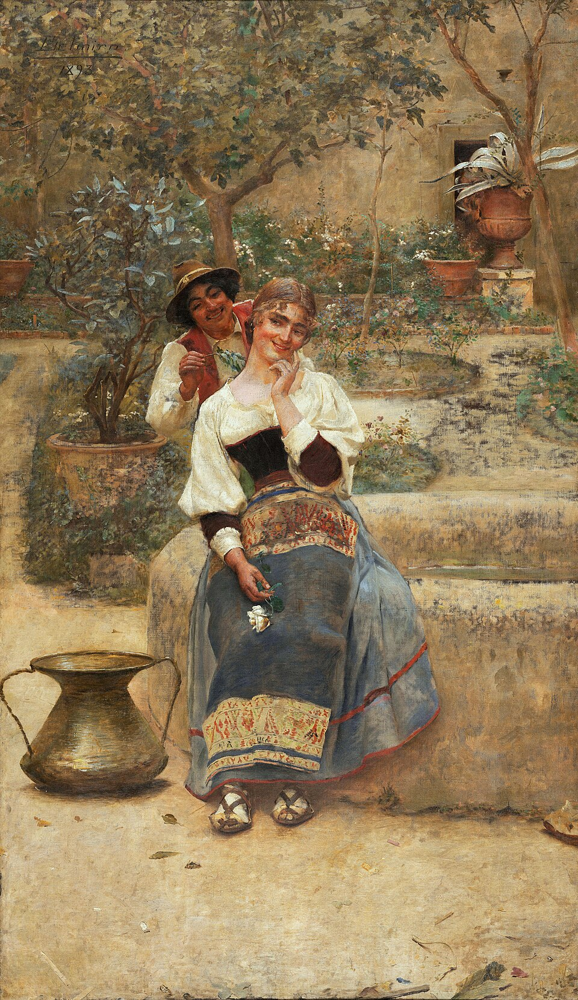

```{r}
#| label: setup
source(here::here("R/mapa.R"))
source(here::here("R/aula04_pgls.R"))

numm <- function(x, d = 2) sub(",", "{,}", num(x, d), fixed = TRUE)
pval <- function(p) if (p < .001) "< 0,001" else paste("=", num(p, 3))

gp  <- gls_passos()
m   <- modelos_anolis()
tt  <- summary(m$pgls)$tTable
s   <- sinal_residuos()
av  <- anova_filo(m)
anc <- anova(gls(hll ~ svl + eco, m$dados, correlation = corBrownian(1, m$arvore, form = ~sp)))
gl  <- glm_filo(m)
cl  <- summary(gl$lg)$coefficients; cp <- summary(gl$po)$coefficients
ev  <- evol_vcv_sunfish()
inc <- incerteza()
```

## Hoje {.muito-grande}

1. Do OLS ao GLS
2. PGLS na prática
3. Diagnóstico
4. ANOVA e ANCOVA filogenéticas
5. Além do PGLS: GLM filogenético
6. Quando a correlação muda na árvore
7. Incerteza filogenética

## Onde estamos

```{r}
#| fig-height: 5.0
#| fig-alt: "Mapa dos métodos com a célula dos atributos contínuos associados (PIC, PGLS, ANOVA filogenética, GLM filogenético) destacada."
mapa_plot(aula = 4)
```

# 1. Do OLS ao GLS {.secao}

[Estão associados?]{.familia .relacao}

## Antes, relembrando o modelo linear (OLS)

```{r}
#| fig-height: 4.1
#| fig-alt: "Dispersão de 14 pontos com a reta de regressão; os resíduos aparecem como segmentos verticais entre cada ponto e a reta, e a equação y igual a b0 mais b1 x mais e está escrita no canto."
fig_ols()
```

Os mínimos quadrados escolhem a reta que minimiza a soma dos resíduos ao
quadrado.

## Pressupostos do OLS (Gauss-Markov) {.muito-grande .tabela-grande}

| Matemática | Tradução para língua humana |
|---|---|
| $y = X\beta + \varepsilon$ | Relação linear entre $y$ e $X$ |
| $X$ é uma matriz $n \times k$ de posto cheio | As colunas de $X$ são independentes |
| $E(\varepsilon\varepsilon' \mid X) = \sigma^2 I$ | Homocedasticidade e ausência de autocorrelação |
| $\varepsilon \mid X \sim N(0, \sigma^2 I)$ | Resíduos normais, com média zero e variância homogênea |

## A linha que ninguém desenha {.grande}

Independência e homocedasticidade são **duas afirmações sobre a mesma
matriz**:

$$
\operatorname{var}[\varepsilon_i \mid X] = \sigma^2
\qquad
\operatorname{cov}[\varepsilon_i, \varepsilon_j \mid X] = 0 \;\; (i \neq j)
$$

$$
E(\varepsilon\varepsilon' \mid X) =
\begin{bmatrix}
\sigma^2 & 0 & \cdots & 0 \\
0 & \sigma^2 & \cdots & 0 \\
\vdots & \vdots & \ddots & \vdots \\
0 & 0 & \cdots & \sigma^2
\end{bmatrix}
= \sigma^2 I
$$

::: {.ref}
Reaproveitado do curso de Análise de Dados Univariados. Ver [Zuur et al. (2009)](https://doi.org/10.1007/978-0-387-87458-6).
:::

## Toda violação é um buraco nessa matriz {.grande}

$$
\underbrace{\sigma^2\begin{bmatrix}1&0&0&0\\0&1&0&0\\0&0&1&0\\0&0&0&1\end{bmatrix}}_{\text{OLS}}
\qquad
\underbrace{\begin{bmatrix}\sigma_1^2&0&0&0\\0&\sigma_2^2&0&0\\0&0&\sigma_3^2&0\\0&0&0&\sigma_4^2\end{bmatrix}}_{\text{variância desigual}}
\qquad
\underbrace{\sigma^2\begin{bmatrix}1{,}44&1{,}26&0{,}20&0{,}20\\1{,}26&1{,}44&0{,}20&0{,}20\\0{,}20&0{,}20&1{,}44&1{,}42\\0{,}20&0{,}20&1{,}42&1{,}44\end{bmatrix}}_{\text{filogenia: } \sigma^2\mathbf{C}}
$$

::: {.definicao}
A filogenia preenche o que está **fora da diagonal**, com a matriz **C** da
Aula 2 (aqui, as espécies 1 a 4 da árvore-guia).
:::

## O estimador GLS

<br>

$$\Large \hat\beta_{\text{GLS}} = \big(X' \color{#1c6e8c}{\mathbf{C}^{-1}} X\big)^{-1} X' \color{#1c6e8c}{\mathbf{C}^{-1}} y$$

<br>

::: {.fragment}
Com $\color{#1c6e8c}{\mathbf{C}} = I$ (uma estrela), volta a ser o OLS:
$\hat\beta = (X'X)^{-1}X'y$.
:::

::: {.fragment}
**PGLS** é o GLS com a matriz **C** da filogenia (ou uma transformação dela
por um modelo evolutivo).
:::

::: {.ref}
Filogenia, espaço e tempo são o mesmo problema estatístico, dados correlacionados: [Ives & Zhu (2006)](https://doi.org/10.1890/04-0702), *Ecol. Appl.* 16: 20–32.
:::

## GLS na árvore-guia

```{r}
#| fig-height: 3.7
#| fig-alt: "Atributo B contra A nas 7 espécies da árvore-guia, com duas retas: a do OLS, quase plana, inclinação 0,13; e a do GLS com C, íngreme, inclinação 1,40."
fig_ols_gls()
```

[OLS (**C** = **I**)]{style="color:#a15e3f"}: inclinação `r num(gp$b_ols[2], 3)`; [GLS com **C**]{style="color:#1c6e8c"}: `r num(gp$b_gls[2], 3)`, a mesma dos contrastes independentes da Aula 2. Sob BM, a equivalência é exata.

::: {.ref}
[Blomberg, Lefevre, Wells & Waterhouse (2012)](https://doi.org/10.1093/sysbio/syr118), *Syst. Biol.* 61: 382–391.
:::

## Quando usar o PGLS {.muito-grande}

- Normalmente, para testar a associação entre atributos
- Muito flexível: preditores contínuos, discretos (binários ou com vários
  estados) e combinações
- Resposta binária: regressão logística filogenética (`phylolm::phyloglm`)
- Pode incorporar diferentes modelos evolutivos, manipulando a estrutura
  de **C**

::: {.ref}
[Grafen (1989)](https://doi.org/10.1098/rstb.1989.0106), *Phil. Trans. R. Soc. B* 326: 119–157.
:::

# 2. PGLS na prática {.secao}

[Estão associados?]{.familia .relacao}

## A estimativa depende do modelo em **C**

```{r}
#| fig-height: 3.9
#| fig-alt: "Membro posterior contra SVL dos Anolis, com quatro retas quase sobrepostas, uma para cada estrutura de covariância: OLS, BM, lambda igual a 0,5 e OU com alfa 5; as inclinações vão de 1,03 a 1,06."
fig_modelos_C()
```

Assume linearidade; a estimativa depende do modelo evolutivo. Nos
*Anolis*, a inclinação muda pouco, mas em outros dados pode mudar muito.

::: {.ref}
[Symonds & Blomberg (2014)](https://doi.org/10.1007/978-3-662-43550-2_5); ideia da figura: [Mazel et al. (2016)](https://doi.org/10.1890/15-0086.1), *Ecology* 97: 286–293.
:::

## Erro comum num PGLS {.muito-grande}

::: {.definicao}
**Errado**: testar o sinal filogenético na variável resposta ou na
preditora para decidir se usa o PGLS.

**Certo**: o pressuposto é sobre os **resíduos**.
:::

::: {.fragment}
O melhor é ajustar um único modelo que estima, por máxima verossimilhança,
o λ dos resíduos **junto** com os coeficientes da regressão.

::: {.ref}
[Revell (2010)](https://doi.org/10.1111/j.2041-210x.2010.00044.x), *Methods Ecol. Evol.* 1: 319–329.
:::
:::

## Variáveis com sinal, resíduos sem sinal

```{r}
#| fig-height: 4.1
#| fig-alt: "Barras do K de Blomberg: 1,15 para X, 1,00 para Y e 0,22 para os resíduos da regressão de Y em X."
fig_sinal_residuos(s)
```

X e Y simulados com sinal forte, mas Y = 1 + 1,2X + um erro **sem**
estrutura filogenética: o λ dos resíduos é `r num(s$lambda_res, 2)`, e o OLS
seria adequado.

## Membros posteriores dos *Anolis*

```{r}
#| fig-alt: "Log do membro posterior contra log do SVL de 82 espécies de Anolis, coloridas por ecomorfo; a reta do OLS (tracejada) e a do PGLS com lambda (contínua) quase coincidem."
fig_anolis_pgls(m)
```

## O modelo em R {.muito-grande}

```{r}
#| echo: true
#| eval: false
nlme::gls(hll ~ svl, data = dados, method = "ML",
          correlation = ape::corPagel(1, arvore, form = ~sp))
```

::: {.tabela-grande}

| | Estimativa | EP | *p* |
|---|---:|---:|---:|
| Intercepto | `r num(tt[1, 1], 3)` | `r num(tt[1, 2], 3)` | `r pval(tt[1, 4])` |
| log SVL | `r num(tt[2, 1], 3)` | `r num(tt[2, 2], 3)` | `r pval(tt[2, 4])` |

:::

λ estimado: `r num(m$lambda, 3)`.

::: {.nota}
O `corPagel` pode dar λ um pouco acima de 1.
:::

# 3. Diagnóstico {.secao}

[Estão associados?]{.familia .relacao}

## Diagnosticando um PGLS

```{r}
#| fig-height: 3.6
#| fig-alt: "Quatro gráficos de diagnóstico do PGLS dos Anolis com resíduos normalizados: contra os valores ajustados, gráfico quantil-quantil, histograma e contra o SVL; um grupo de resíduos negativos aparece separado."
fig_diagnostico(m)
```

Use os resíduos **normalizados** (`resid(modelo, type = "normalized")`):
os resíduos brutos de um GLS continuam correlacionados pela filogenia.

::: {.nota}
O grupo de resíduos negativos são os *twig*, de membros curtos: um
preditor que falta no modelo (bloco 4).
:::

## Armadilhas comuns {.muito-grande}

- **Nomes**: as pontas da árvore e as linhas da tabela precisam bater
  (`geiger::name.check()`)
- **Ordem das linhas**: no `nlme::gls`, diga qual coluna identifica a
  espécie (`form = ~sp`); sem isso, a correlação é aplicada na ordem das
  linhas
- **Árvore**: ultramétrica e com comprimentos de ramo (Aula 1)

# 4. ANOVA e ANCOVA filogenéticas {.secao}

[Estão associados?]{.familia .relacao}

## Um preditor categórico: o ecomorfo

```{r}
#| fig-height: 4.1
#| fig-alt: "Membro posterior relativo (resíduo do PGLS) por ecomorfo: trunk-ground e grass-bush com membros longos, twig com membros curtos, os demais no meio; linhas pretas marcam as médias."
fig_ecomorfos(m)
```

Membro posterior relativo: resíduo da regressão no SVL.

::: {.ref}
Ecomorfos dos *Anolis*: [Losos (1990)](https://doi.org/10.2307/1943062), *Ecol. Monogr.* 60: 369–388.
:::

## ANOVA filogenética

```{r}
#| fig-height: 3.8
#| fig-alt: "Histograma de valores de F simulados sob BM na árvore dos Anolis, quase todos abaixo de 10, com o F crítico da ANOVA comum perto de 2,3 e o F observado, 55,6, muito à direita."
fig_anova_filo(av)
```

O valor crítico de F vem de simulações sob BM na árvore, e não da tabela
F: F = `r num(av$F, 1)`, *p* `r pval(av$p)`.

::: {.ref}
[Garland, Dickerman, Janis & Jones (1993)](https://doi.org/10.2307/2992464), *Syst. Biol.* 42: 265. Em R: `phytools::phylANOVA`.
:::

## ANCOVA filogenética {.muito-grande}

```{r}
#| echo: true
#| eval: false
nlme::gls(hll ~ svl + eco, data = dados,
          correlation = ape::corBrownian(1, arvore, form = ~sp))
```

::: {.tabela-grande}

| Termo | gl | F | *p* |
|---|---:|---:|---:|
| log SVL | `r anc[2, "numDF"]` | `r num(anc[2, "F-value"], 1)` | `r pval(anc[2, "p-value"])` |
| ecomorfo | `r anc[3, "numDF"]` | `r num(anc[3, "F-value"], 1)` | `r pval(anc[3, "p-value"])` |

:::

::: {.ref}
[Revell & Harmon (2022)](https://press.princeton.edu/books/paperback/9780691219035/phylogenetic-comparative-methods-in-r), seção 3.5.
:::

# 5. Além do PGLS: GLM filogenético {.secao}

[Estão associados?]{.familia .relacao}

## Respostas binárias e contagens

```{r}
#| fig-height: 3.8
#| fig-alt: "À esquerda, ser trunk-ground (0 ou 1) contra o membro posterior relativo, com a curva logística ajustada subindo. À direita, número de lamelas contra log SVL, com a curva de Poisson ajustada."
fig_glm_filo(gl)
```

```{r}
#| echo: true
#| eval: false
phylolm::phyloglm(tg ~ membro, data = dados, phy = arvore, method = "logistic_MPLE")
phylolm::phyloglm(lamelas ~ svl, data = dados, phy = arvore, method = "poisson_GEE")
```

::: {.ref}
[Ives & Garland (2010)](https://doi.org/10.1093/sysbio/syp074); [Paradis & Claude (2002)](https://doi.org/10.1006/jtbi.2002.3066); [Ho & Ané (2014)](https://doi.org/10.1093/sysbio/syu005).
:::

## Lendo os dois modelos {.grande .tabela-grande}

| Modelo | Coeficiente | Estimativa | *p* |
|---|---|---:|---:|
| Logística | membro posterior (DP) | `r num(cl[2, 1])` | `r pval(cl[2, 4])` |
| Poisson | log SVL | `r num(cp[2, 1])` | `r pval(cp[2, 4])` |

DP: desvio padrão do membro posterior relativo. *Trunk-ground* têm membros posteriores relativamente longos; espécies
maiores têm mais lamelas.

::: {.nota}
Lamelas: contagem reconstruída do log dos dados do `phytools`
(`round(exp(LAM))`, de 13 a 42).
:::

# 6. Quando a correlação muda na árvore {.secao}

[Estão associados?]{.familia .relacao}

## Matrizes de covariância evolutiva por regime {.muito-grande}

E se a correlação entre dois atributos for diferente em partes da árvore
(não estacionariedade)?

::: {.ref}
[Revell & Collar (2009)](https://doi.org/10.1111/j.1558-5646.2009.00616.x), *Evolution* 63: 1090–1100.
:::

::: {.fragment}
Versão bayesiana, com a incerteza das correlações: o pacote `ratematrix`.

::: {.ref}
[Caetano & Harmon (2017)](https://doi.org/10.1111/2041-210x.12826), *Methods Ecol. Evol.* 8: 1920–1927.
:::
:::

## Os peixes Centrarchidae

```{r}
#| fig-height: 4.6
#| fig-alt: "À esquerda, a filogenia de 28 espécies de Centrarchidae com os ramos piscívoros em vermelho e os não piscívoros em azul. À direita, abertura da boca contra comprimento bucal, ambos corrigidos pelo tamanho, com os piscívoros em vermelho."
fig_sunfish()
```

Os regimes (piscívoro ou não) são definidos **a priori** e mapeados nos
ramos.

## Uma ou duas matrizes? {.grande .tabela-grande}

| Modelo | var(abertura) | cov | var(bucal) | log L |
|---|---:|---:|---:|---:|
| Uma matriz | `r num(ev$R.single[1, 1], 3)` | `r num(ev$R.single[1, 2], 3)` | `r num(ev$R.single[2, 2], 3)` | `r num(ev$logL1, 2)` |
| Não piscívoros | `r num(ev$R.multiple[1, 1, 1], 3)` | `r num(ev$R.multiple[1, 2, 1], 3)` | `r num(ev$R.multiple[2, 2, 1], 3)` | `r num(ev$logL.multiple, 2)` |
| Piscívoros | `r num(ev$R.multiple[1, 1, 2], 3)` | `r num(ev$R.multiple[1, 2, 2], 3)` | `r num(ev$R.multiple[2, 2, 2], 3)` | |

Razão de verossimilhança: *p* `r pval(ev$P.chisq)`. Nos piscívoros, os dois
atributos evoluem juntos; nos outros, quase não covariam.

::: {.nota}
Calculado com `phytools::evol.vcv` nos dados `sunfish` do `phytools`. O log
L de uma matriz bate com o do artigo (72,19); o de duas não (lá, 76,85), e
as taxas estão em outra escala.
:::

# 7. Incerteza filogenética {.secao}

[Estão associados?]{.familia .relacao}

## A árvore também é uma estimativa

```{r}
#| fig-height: 3.6
#| fig-alt: "Histograma das inclinações do PGLS de membro posterior contra SVL em 100 árvores com comprimentos de ramo perturbados, entre cerca de 1,01 e 1,09, com a linha da árvore original no meio."
fig_incerteza(inc)
```

Refaça a análise numa amostra de árvores (uma posterior bayesiana, por
exemplo) e relate a variação. Aqui, 100 árvores com ramos perturbados:
inclinação de `r num(quantile(inc$b, .025), 3)` a `r num(quantile(inc$b, .975), 3)`.

::: {.ref}
Ilustração simulada. [Rangel et al. (2015)](https://doi.org/10.1111/evo.12644), *Evolution* 69: 1301–1312.
:::

# Para fechar {.secao}

## Onde estamos

```{r}
#| fig-height: 5.0
#| fig-alt: "O mapa dos métodos de novo, com a célula dos atributos contínuos associados destacada."
mapa_plot(aula = 4)
```

## Leituras {.muito-grande}

- [Revell & Harmon (2022)](https://press.princeton.edu/books/paperback/9780691219035/phylogenetic-comparative-methods-in-r), *Phylogenetic Comparative Methods in R*: cap. 3 (PGLS, ANOVA e ANCOVA filogenéticas)
- [Symonds & Blomberg (2014)](https://doi.org/10.1007/978-3-662-43550-2_5): um guia do PGLS
- [Revell (2010)](https://doi.org/10.1111/j.2041-210x.2010.00044.x): sinal nos resíduos

::: {.definicao}
Antes de usar qualquer método, leia o artigo que o propôs. Não fazer isso
pode causar a rejeição do seu manuscrito.
:::

## Agora é com vocês

::: {.meme}
{fig-alt="Pintura Bom tempo ou Idílio campestre, de Belmiro de Almeida: uma moça sorridente sentada num muro de pedra; atrás dela, um rapaz de chapéu se inclina para falar ao seu ouvido. Legenda: X e Y, um casal? Não: parentes." height="560px"}

[X e Y, um casal?]{.meme-topo} [Não: parentes]{.meme-base}
:::

::: {.ref}
Belmiro de Almeida, *Bom tempo* ou *Idílio campestre* (1893), domínio público, via Wikimedia Commons. Prática: o walkthrough da Aula 4 e o desafio.
:::
