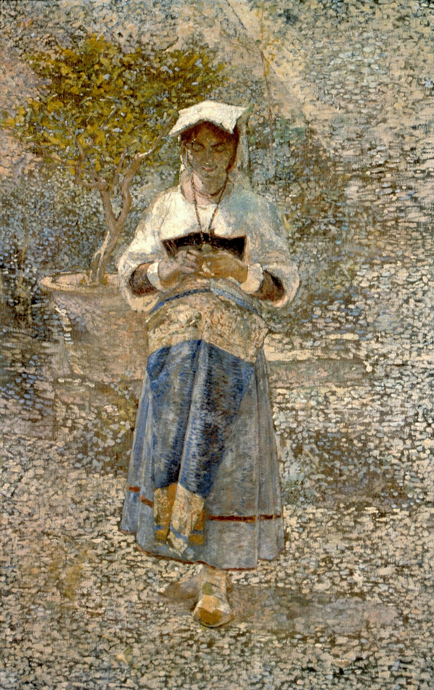

```{r}
#| label: setup
source(here::here("R/mapa.R"))
source(here::here("R/aula05_modelos.R"))

numm <- function(x, d = 2) sub(",", "{,}", num(x, d), fixed = TRUE)
vb  <- bm_verossimilhanca()
aj  <- ajustes_anolis(); ta <- aj$tab
ar  <- ajustes_regimes(); tr_ <- ar$tab
oum_a <- ar$oum$alpha
bs  <- brownie_sunfish()
```

## Hoje {.grande}

1. Verossimilhança: estimando σ² e a raiz
2. O modelo Ornstein-Uhlenbeck
3. *Early burst* e tendência
4. Comparando modelos
5. Adequação do modelo
6. Além dos quatro: BBM, FPK e evolução pulsada
7. Paisagens adaptativas e radiação
8. Várias taxas e vários regimes
9. Cautelas com o OU

## Onde estamos

```{r}
#| fig-height: 5.0
#| fig-alt: "Mapa dos métodos com a célula dos modelos de evolução de atributos contínuos destacada."
mapa_plot(aula = 5)
```

# 1. Verossimilhança: estimando σ² e a raiz {.secao}

[Como evolui?]{.familia .modelos}

## A verossimilhança do BM {.grande}

Sob BM, os valores das pontas seguem uma normal multivariada com média na
raiz e covariância σ²**C** (Aula 2):

$$\mathbf{X} \sim N\big(z_0 \mathbf{1},\ \sigma^2 \mathbf{C}\big)$$

$$\log L(z_0, \sigma^2) = -\tfrac{1}{2}\Big[n \log(2\pi) + n \log \sigma^2 + \log|\mathbf{C}| + \tfrac{(\mathbf{X} - z_0\mathbf{1})' \mathbf{C}^{-1} (\mathbf{X} - z_0\mathbf{1})}{\sigma^2}\Big]$$

::: {.fragment}
Os valores de $z_0$ e $\sigma^2$ que maximizam log L são as estimativas de
máxima verossimilhança.
:::

## Atributo A da árvore-guia

```{r}
#| fig-height: 4.0
#| fig-alt: "Log-verossimilhança do BM para o atributo A em função de sigma ao quadrado, com o máximo marcado em 0,356."
fig_bm_logL(vb)
```

$\hat\sigma^2 = `r numm(vb$s2, 3)`$ e $\hat z_0 = `r numm(vb$z0, 2)`$: a raiz estimada é a mesma dos
contrastes (Aula 2) e é o primeiro "estado ancestral" (Aula 7).

# 2. O modelo Ornstein-Uhlenbeck {.secao}

[Como evolui?]{.familia .modelos}

## Ornstein-Uhlenbeck (OU) {.grande}

- Captura a ideia de **evolução estabilizadora**
- O valor de um caráter contínuo tende a se mover para um **valor ótimo**
- Um movimento browniano com um "puxão"
- Parâmetros: valor inicial ($z_0$), taxa ($\sigma^2$), ótimo ($\theta$) e
  força de restrição ($\alpha$)

::: {.fragment}
**Vantagens**: tratável matematicamente; parâmetros com interpretação
biológica; α limita o BM; θ pode representar regimes, ótimos ou zonas
adaptativas.
:::

::: {.nota}
No original, θ aparecia como "valor inicial": no OU, θ é o **ótimo**.
:::

## O processo de Ornstein-Uhlenbeck {.grande}

- Modelo para a velocidade de uma partícula browniana sob atrito, proposto
  por dois físicos holandeses, Leonard Ornstein (1880–1941) e George
  Uhlenbeck (1900–1988)
- Também chamado de movimento de "reversão à média"
- A partícula pode ser atraída para uma média diferente da inicial
- É como atributos que evoluem em direção a **picos adaptativos**, que podem
  limitar a diversificação

::: {.ref}
[Uhlenbeck & Ornstein (1930)](https://doi.org/10.1103/physrev.36.823), *Phys. Rev.* 36: 823–841.
:::

## A equação do OU {.muito-grande}

<br>

$$\Large dX = \color{#527238}{\alpha}\,\big[\color{#a15e3f}{\theta} - X\big]\,dt + \color{#1c6e8c}{\sigma\, dB}$$

<br>

::: {.fragment}
[$\sigma\,dB$]{style="color:#1c6e8c"}: o movimento browniano (Aula 2)
:::

::: {.fragment}
[$\alpha[\theta - X]\,dt$]{style="color:#527238"}: a mudança em direção ao ótimo
[$\theta$]{style="color:#a15e3f"}
:::

## A equação do OU: o puxão {.muito-grande}

- A força da seleção é proporcional à **distância** entre o valor do
  atributo e o ótimo: quanto maior a distância, maior o "puxão"
- $\alpha$ diz a força desse puxão

::: {.fragment}
$$dX = \color{#527238}{0}\cdot[\theta - X]\,dt + \sigma\,dB = \sigma\,dB$$

Com $\alpha = 0$, o OU vira um BM.
:::

## Simulando o OU: o ótimo θ

```{r}
#| fig-alt: "Quinze trajetórias de OU partindo de zero com theta igual a 4 e igual a 8: as trajetórias sobem e oscilam em torno do ótimo, marcado com uma linha tracejada."
fig_ou_param("theta")
```

## Simulando o OU: a força α

```{r}
#| fig-alt: "Com alfa igual a 0,03, as trajetórias chegam devagar ao ótimo e espalham muito; com alfa igual a 0,3, chegam rápido e ficam concentradas em torno dele."
fig_ou_param("alfa")
```

α maior: o ótimo é alcançado mais rápido, e a variância é menor.

## Simulando o OU: a taxa σ²

```{r}
#| fig-height: 4.0
#| fig-alt: "Com sigma ao quadrado igual a 0,1, as trajetórias ficam próximas do ótimo; com 1, oscilam muito mais em torno dele."
fig_ou_param("sigma2")
```

σ² maior: mais variância em torno do ótimo.

::: {.ref}
Simulações inspiradas em [Butler & King (2004)](https://doi.org/10.1086/426002) e em Harmon (2019).
:::

## BM é diversificante; OU é de equilíbrio

```{r}
#| fig-height: 3.9
#| fig-alt: "Variância entre 1500 réplicas ao longo do tempo: sob BM cresce em linha reta; sob OU estabiliza logo, perto de sigma ao quadrado sobre 2 alfa."
fig_bm_vs_ou()
```

Sob BM, a variância cresce como $\sigma^2 t$; sob OU, estabiliza em
$\sigma^2/2\alpha$. Tempo para percorrer metade do caminho até o ótimo:
a **meia-vida filogenética**, $\ln 2/\alpha$.

## O OU na biologia evolutiva {.grande .tabela-grande}

| Ano | Trabalho | Contribuição |
|---|---|---|
| 1976 | [Lande](https://doi.org/10.2307/2407703) | seleção natural e deriva na evolução fenotípica |
| 1979 | [Lande](https://doi.org/10.2307/2407630) | genética quantitativa da evolução multivariada (alometria cérebro–corpo) |
| 1988 | [Felsenstein](https://doi.org/10.1146/annurev.es.19.110188.002305) | o OU como "elástico" que puxa a população para o pico seletivo |
| 1997 | [Hansen](https://doi.org/10.2307/2411186) | seleção estabilizadora e análise comparativa da adaptação |
| 2004 | [Butler & King](https://doi.org/10.1086/426002) | OU com vários regimes (`ouch`) |

# 3. *Early burst* e tendência {.secao}

[Como evolui?]{.familia .modelos}

## *Early burst* (EB) {.grande}

- A taxa de evolução **desacelera** com o tempo: é maior perto da raiz
- Corresponde à ideia de **radiação adaptativa**: linhagens que entram em
  novas zonas adaptativas diversificam rápido, e a taxa cai à medida que os
  nichos são preenchidos
- Parâmetros: valor inicial ($z_0$), taxa inicial ($\sigma_0^2$) e taxa de
  mudança ($r$)

$$V(t) = \sigma_0^2\, \frac{e^{rt} - 1}{r}$$

::: {.ref}
Zonas adaptativas: Simpson (1944), *Tempo and mode in evolution*.
:::

## *Early burst* e *late burst*

```{r}
#| fig-height: 4.0
#| fig-alt: "Vinte trajetórias sob early burst, que se espalham rápido no início e depois quase param, e sob late burst, que começam juntas e se espalham no fim."
fig_acdc()
```

Com $r < 0$, desacelera (EB); com $r > 0$, acelera.

::: {.ref}
O modelo ACDC de [Blomberg, Garland & Ives (2003)](https://doi.org/10.1554/0014-3820(2003)057[0717:tfpsic]2.0.co;2).
:::

## Onde está a variação?

```{r}
#| fig-height: 4.0
#| fig-alt: "Proporção da variação do atributo que fica dentro dos 8 maiores clados dos Anolis, em 200 simulações: cerca de 60 por cento sob BM, perto de 90 por cento sob OU forte e cerca de 20 por cento sob early burst."
fig_dentro_entre()
```

Sob EB, a variação se concentra **entre** os clados antigos; sob OU forte,
**dentro** deles.

::: {.ref}
Ideia da figura de [Harmon et al. (2010)](https://doi.org/10.1111/j.1558-5646.2010.01025.x).
:::

## Movimento browniano com tendência {.muito-grande}

- Incorpora a ideia de mudança **direcional** do fenótipo ao longo do tempo
- Regra de Cope (ou de Depéret): o tamanho do corpo aumenta ao longo do
  tempo dentro das linhagens

$$dX = \mu\, dt + \sigma\, dB$$

::: {.ref}
[Bokma, Godinot, Maridet et al. (2016)](https://doi.org/10.1093/sysbio/syv075), *Syst. Biol.* 65: 98–108; [Lamsdell & Braddy (2010)](https://doi.org/10.1098/rsbl.2009.0700), *Biol. Lett.* 6: 265–269.
:::

## BM com tendência

```{r}
#| fig-height: 3.4
#| fig-alt: "Dez trajetórias com tendência positiva, que sobem, e dez com tendência negativa, que descem."
fig_tendencia()
```

::: {.definicao}
Numa árvore só de espécies atuais (ultramétrica), a tendência **não se
distingue** do BM: é preciso fósseis.
:::

::: {.ref}
[Finarelli & Flynn (2006)](https://doi.org/10.1080/10635150500541698), *Syst. Biol.* 55: 301–313.
:::

# 4. Comparando modelos {.secao}

[Como evolui?]{.familia .modelos}

## Seleção de modelos e AIC {.grande}

> "All models are wrong, but some are useful" (George E. P. Box)

- Compara o suporte de cada modelo
- AIC e BIC levam em conta o ajuste (verossimilhança) e o número de
  parâmetros: mais parâmetros sempre ajustam melhor
- BM, OU, EB e tendência têm números diferentes de parâmetros
- Escolha o modelo que é a aproximação mais eficiente da "verdade"; com
  poucas espécies, use o AICc e os pesos de Akaike

::: {.ref}
Burnham & Anderson, [*Model selection and multimodel inference*](https://doi.org/10.1007/b97636), Springer.
:::

## O tamanho do corpo dos *Anolis* {.muito-grande .tabela-grande}

```{r}
#| echo: true
#| eval: false
geiger::fitContinuous(arvore, svl, model = "BM")   # e "OU", "EB"
```

| Modelo | k | log L | AICc | ΔAICc | peso |
|---|---:|---:|---:|---:|---:|
| `r ta$modelo[1]` | `r ta$k[1]` | `r num(ta$logL[1])` | `r num(ta$AICc[1])` | `r num(ta$dAICc[1])` | `r num(ta$peso[1])` |
| `r ta$modelo[2]` | `r ta$k[2]` | `r num(ta$logL[2])` | `r num(ta$AICc[2])` | `r num(ta$dAICc[2])` | `r num(ta$peso[2])` |
| `r ta$modelo[3]` | `r ta$k[3]` | `r num(ta$logL[3])` | `r num(ta$AICc[3])` | `r num(ta$dAICc[3])` | `r num(ta$peso[3])` |

Nenhum modelo se destaca: o EB tem o maior peso, mas o BM fica perto.

## Duas lições da literatura {.muito-grande}

**O EB é raro**: pouco suporte para o EB no tamanho e na forma do corpo,
mesmo em exemplos clássicos de radiação adaptativa; e o BM às vezes ajusta
mal.

::: {.ref}
[Harmon, Losos, Davies et al. (2010)](https://doi.org/10.1111/j.1558-5646.2010.01025.x), *Evolution*.
:::

::: {.fragment}
**O erro de medida** (e a variação intraespecífica) deve entrar sempre no
modelo: ignorá-lo favorece modelos mais complexos, como o OU.

::: {.ref}
[Silvestro et al. (2015)](https://doi.org/10.1111/2041-210x.12337), *Methods Ecol. Evol.* 6: 340–346. Em `fitContinuous`: argumento `SE`.
:::
:::

# 5. Adequação do modelo {.secao}

[Como evolui?]{.familia .modelos}

## Ajuste relativo × adequação {.muito-grande}

- A abordagem de teoria da informação (AIC) aponta o **melhor** modelo
  entre os disponíveis; o peso de Akaike ajuda a ver o quanto melhor
- Mas o melhor pode explicar pouco dos dados (R² baixo, por exemplo)
- O que fazer? Testar a **adequação** do modelo: os dados se parecem com o
  que o modelo gera?

::: {.ref}
Arbutus: [Pennell, FitzJohn, Cornwell & Harmon (2015)](https://doi.org/10.1086/682022), *Am. Nat.* 186: E33–E50. Monte Carlo filogenético: [Boettiger, Coop & Ralph (2012)](https://doi.org/10.1111/j.1558-5646.2011.01574.x), *Evolution* 66: 2240–2251.
:::

## O ciclo do Arbutus

```{r}
#| fig-height: 3.6
#| fig-alt: "Seis caixas em ciclo: ajustar o modelo aos dados; transformar a árvore pelo modelo ajustado; calcular estatísticas nos dados observados; simular muitos conjuntos na árvore transformada; calcular as estatísticas nos simulados; comparar."
fig_arbutus()
```

A ideia: modificar a árvore para descrever a história do atributo; quanto
mais os dados observados se parecem com os simulados, melhor o modelo.
Também serve para o PGLS.

# 6. Além dos quatro: BBM, FPK e evolução pulsada {.secao}

[Como evolui?]{.familia .modelos}

## BM com limites (BBM)

```{r}
#| fig-height: 3.7
#| fig-alt: "Oito trajetórias de movimento browniano refletidas entre dois limites, marcados com linhas vermelhas."
fig_bbm()
```

O atributo evolui como BM, mas entre **limites** (fisiológicos, por
exemplo). Ajuda a separar um OU de um BM limitado.

::: {.ref}
[Boucher & Démery (2016)](https://doi.org/10.1093/sysbio/syw015), *Syst. Biol.* 65: 651–661.
:::

## Paisagens macroevolutivas: o modelo FPK

```{r}
#| fig-height: 3.4
#| fig-alt: "Quatro curvas de potencial: plana para o BM, um poço para o OU, uma caixa para o BBM e uma curva com dois vales para o FPK."
fig_potenciais()
```

O atributo "desce" para os vales do potencial. BM, OU e BBM são casos
particulares; o FPK estima a **forma** da paisagem a partir dos dados.

::: {.ref}
[Boucher, Démery, Conti, Harmon & Uyeda (2018)](https://doi.org/10.1093/sysbio/syx075), *Syst. Biol.* 67: 304–319.
:::

## Evolução pulsada

```{r}
#| fig-height: 3.7
#| fig-alt: "Doze trajetórias de um movimento browniano com saltos raros e grandes."
fig_levy()
```

Saltos raros e grandes sobre um BM (processos de Lévy): a evolução pulsada
explica melhor o tamanho do corpo dos vertebrados do que mudanças graduais.

::: {.ref}
[Landis & Schraiber (2017)](https://doi.org/10.1073/pnas.1710920114), *PNAS* 114: 13224–13229.
:::

# 7. Paisagens adaptativas e radiação {.secao}

[Como evolui?]{.familia .modelos}

## Radiação adaptativa {.grande}

Critérios de Simpson (a "paisagem de Simpson") para detectar radiações:

- dispersão para novas áreas geográficas
- surgimento de um atributo-chave
- extinção em massa de competidores
- ocupação de novos "nichos" ou zonas adaptativas

::: {.fragment}
Se os atributos evoluem com **taxas** diferentes em linhagens diferentes,
comparamos modelos com $\sigma^2$ e $\theta$ diferentes.
:::

::: {.ref}
Simpson (1944), *Tempo and mode in evolution*.
:::

## A metáfora da paisagem adaptativa

```{r}
#| fig-width: 7
#| fig-height: 4.2
#| out-width: "55%"
#| fig-alt: "Superfície de aptidão sobre dois atributos, com dois picos de alturas diferentes."
fig_paisagem()
```

Picos de aptidão (Wright 1932) e zonas adaptativas (Simpson 1944); as
paisagens também mudam no tempo. Em *Cyprinodon* das Bahamas, a paisagem
medida no campo tem vários picos, que ajudam a explicar a radiação.

::: {.ref}
[Martin & Wainwright (2013)](https://doi.org/10.1126/science.1227710), *Science* 339: 208–211.
:::

# 8. Várias taxas e vários regimes {.secao}

[Como evolui?]{.familia .modelos}

## BM com várias taxas {.grande}

- Taxas ($\sigma^2$) diferentes em clados identificados **a priori** (o
  programa Brownie)
- Centrarchidae, abertura da boca: σ² = `r num(bs$sig2.multiple["non"], 3)`
  nos não piscívoros e `r num(bs$sig2.multiple["pisc"], 3)` nos piscívoros;
  razão de verossimilhança *p* = `r num(bs$P.chisq, 3)`

```{r}
#| echo: true
#| eval: false
phytools::brownie.lite(arvore_com_regimes, abertura)
```

::: {.fragment}
Sem definir os clados: uma abordagem bayesiana (rjMCMC) procura onde a taxa muda (`geiger::rjmcmc.bm`; [Eastman et al. 2011](https://doi.org/10.1111/j.1558-5646.2011.01401.x)).
:::

::: {.ref}
[O'Meara, Ané, Sanderson & Wainwright (2006)](https://doi.org/10.1554/05-130.1); [Thomas, Freckleton & Székely (2006)](https://doi.org/10.1098/rspb.2006.3488).
:::

## Os ecomorfos dos *Anolis* {.grande .tabela-grande}

OU com vários regimes (θ, σ² e α por regime): `ouch` ([Butler & King 2004](https://doi.org/10.1086/426002)), `OUwie` ([Beaulieu et al. 2012](https://doi.org/10.1111/j.1558-5646.2012.01619.x)). Aqui, o SVL com os ecomorfos mapeados (árvore com altura 1), no `mvMORPH`:

| Modelo | O que muda entre ecomorfos | log L | AICc | peso |
|---|---|---:|---:|---:|
| BM1 | nada | `r num(tr_$logL[1], 1)` | `r num(tr_$AICc[1], 1)` | `r num(tr_$peso[1], 3)` |
| BMM | a taxa σ² | `r num(tr_$logL[2], 1)` | `r num(tr_$AICc[2], 1)` | `r num(tr_$peso[2], 3)` |
| OU1 | nada (um ótimo) | `r num(tr_$logL[3], 1)` | `r num(tr_$AICc[3], 1)` | `r num(tr_$peso[3], 3)` |
| OUM | o ótimo θ | `r num(tr_$logL[4], 1)` | `r num(tr_$AICc[4], 1)` | `r num(tr_$peso[4], 3)` |

## Um ótimo por ecomorfo

```{r}
#| fig-height: 3.8
#| fig-alt: "SVL das espécies de Anolis por ecomorfo, com o ótimo estimado de cada um como um losango: crown-giant perto de 5,1; grass-bush perto de 3,7; os demais entre 3,9 e 4,1."
fig_otimos(ar)
```

Losangos: os ótimos θ do OUM. Espécies de ilhas diferentes convergem para o
mesmo ótimo do seu ecomorfo.

::: {.ref}
Convergência nos *Anolis*: [Mahler, Ingram, Revell & Losos (2013)](https://doi.org/10.1126/science.1232392), *Science* 341: 292–295.
:::

## Convergência nos *Anolis* do Caribe {.muito-grande}

- Padrões repetidos de convergência dos ecomorfos nas ilhas
- Espécies distantes ocupam os mesmos hábitats e desenvolvem a mesma
  morfologia: restrições do hábitat, preenchimento do espaço de nicho
- A evolução pode ser predita?

::: {.ref}
[Mahler, Ingram, Revell & Losos (2013)](https://doi.org/10.1126/science.1232392), *Science* 341: 292–295.
:::

## Mudanças de regime detectadas automaticamente {.grande}

Sem atribuir os regimes a priori:

- `bayou`: bayesiano (MCMC), com prior para o número de mudanças; detecta
  convergência; um atributo por vez
- `l1ou`: rápido, por verossimilhança penalizada (LASSO)
- PhylogeneticEM: vários atributos correlacionados

::: {.ref}
[Uyeda & Harmon (2014)](https://doi.org/10.1093/sysbio/syu057); [Khabbazian et al. (2016)](https://doi.org/10.1111/2041-210x.12534); [Bastide et al. (2018)](https://doi.org/10.1093/sysbio/syy005).
:::

# 9. Cautelas com o OU {.secao}

[Como evolui?]{.familia .modelos}

## Dificuldades de inferência {.grande}

- É difícil estimar os parâmetros do OU, sobretudo as mudanças de regime
- Importa a razão entre o número de espécies e o de parâmetros
- O estimador de máxima verossimilhança tem problemas
- A posição das mudanças de regime depende pouco do tamanho da árvore
- AIC e BIC tendem a favorecer modelos mais complexos
- Muitas vezes há **pouca informação** nos dados para estimar os parâmetros
  com precisão (Cressler et al. 2015)

::: {.ref}
[Ho & Ané (2014)](https://doi.org/10.1111/2041-210x.12285), *Methods Ecol. Evol.* 5: 1133–1146.
:::

## Recomendações de Ho & Ané (2014) {.grande}

1. Use um BIC corrigido pela filogenia
2. Implementações bayesianas sofrem menos que a seleção de modelos passo a
   passo; teste a influência do prior
3. Compare a meia-vida ($\ln 2/\alpha$) com a altura da árvore: se a
   meia-vida for muito grande, α pode estar mal estimado
4. A ausência de uma mudança pode ser falta de poder, mesmo em árvores
   grandes

::: {.nota}
No OUM dos *Anolis*, a meia-vida é `r num(log(2) / oum_a, 2)` da altura da
árvore: o puxão é forte, e α deve ser lido com cuidado.
:::

## Uma nota de cautela {.grande}

- O erro tipo I é alto com amostras pequenas
- Evite testes de razão de verossimilhança; prefira a seleção de modelos
  (bayesiana)
- O erro de medida infla o erro tipo I
- α é difícil de estimar: veja se o valor faz sentido para os seus dados e
  use a meia-vida

::: {.ref}
[Cooper, Thomas, Venditti, Meade & Freckleton (2016)](https://doi.org/10.1111/bij.12701), *Biol. J. Linn. Soc.* 118: 64–77. Desempenho depende da discriminabilidade, da razão sinal/ruído e do número de espécies: [Cressler, Butler & King (2015)](https://doi.org/10.1093/sysbio/syv043).
:::

## O "lado escuro" dos métodos comparativos {.grande}

- Com pouco erro de medida (ou ignorando a variação intraespecífica), o OU
  tende a ajustar melhor mesmo com um parâmetro a mais, porque acomoda mais
  variância perto das pontas, e não necessariamente por uma causa biológica
- Leia com cuidado antes de usar os métodos no R
- Seja sempre crítico com os resultados
- Relate as análises com ferramentas de reprodutibilidade (Quarto)

::: {.ref}
[Cooper, Thomas & FitzJohn (2016)](https://doi.org/10.1111/2041-210x.12533), *Methods Ecol. Evol.* 7: 693–699.
:::

# Para fechar {.secao}

## Onde estamos

```{r}
#| fig-height: 5.0
#| fig-alt: "O mapa dos métodos de novo, com a célula dos modelos de atributos contínuos destacada."
mapa_plot(aula = 5)
```

## Leituras {.muito-grande}

- [Revell & Harmon (2022)](https://press.princeton.edu/books/paperback/9780691219035/phylogenetic-comparative-methods-in-r), *Phylogenetic Comparative Methods in R*: seções 4.7–4.8, 5.1–5.2 e 5.4
- [Butler & King (2004)](https://doi.org/10.1086/426002): o OU com vários regimes
- [Ho & Ané (2014)](https://doi.org/10.1111/2041-210x.12285) e [Cooper et al. (2016)](https://doi.org/10.1111/bij.12701): as cautelas

::: {.definicao}
Antes de usar qualquer método, leia o artigo que o propôs. Não fazer isso
pode causar a rejeição do seu manuscrito.
:::

## Agora é com vocês

::: {.meme}
{fig-alt="Pintura Efeitos do sol, de Belmiro de Almeida: uma moça de lenço na cabeça lê um papel num jardim iluminado, com o rosto meio encoberto. Legenda: o AIC escolheu o OU; e o alfa? difícil de estimar." height="560px"}

[O AIC escolheu o OU]{.meme-topo} [E o α? Difícil de estimar]{.meme-base}
:::

::: {.ref}
Belmiro de Almeida, *Efeitos do sol* (1892), domínio público, via Wikimedia Commons. Prática: o walkthrough da Aula 5 e o desafio.
:::
