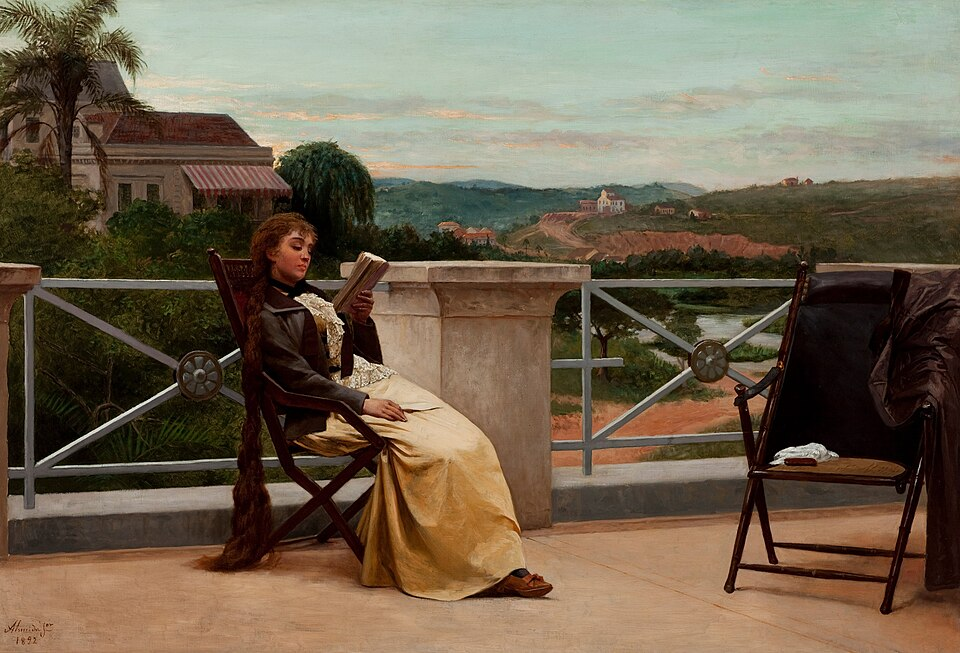

```{r}
#| label: setup
source(here::here("R/mapa.R"))
source(here::here("R/aula08_multivariados.R"))

pin <- pleth_ind(); ps <- pleth_sp()
r  <- multivar_resultados(pin, ps)
b  <- anolis_bmm()
pf <- pca_filo_anolis()
pval <- function(p) if (p < .001) "< 0,001" else paste("=", num(p, 3))
```

## Hoje {.muito-grande}

1. Morfometria geométrica
2. Sinal, taxa e PGLS multivariados
3. Modelos multivariados
4. Modularidade e integração
5. Ordenação filogenética

## Onde estamos

```{r}
#| fig-height: 5.0
#| fig-alt: "Mapa dos métodos com a linha dos atributos multivariados destacada: K multivariado, mvMORPH e taxas por módulo, filomorfoespaço, PGLS multivariado e PCA filogenética."
mapa_plot(aula = 8)
```

# 1. Morfometria geométrica {.secao}

[Como evolui?]{.familia .modelos}

## A morfometria tradicional {.muito-grande}

- Várias medidas lineares, razões e ângulos, que não capturam a **posição**
  dos marcos anatômicos
- Difícil estabelecer homologia entre **distâncias**
- Medidas lineares não capturam a geometria
- Muitas variáveis correlacionadas, que precisam de redução (ex.: PCA)
  antes do uso; o PC1 quase sempre é o tamanho
- Confunde tamanho e forma

## As vantagens da morfometria geométrica {.muito-grande}

- Separa **tamanho** de **forma**, e traz técnicas de visualização
- Mede formas em 2D e em 3D

::: {.definicao}
Forma: "all the geometric information that remains when location, scale and
rotational effects are filtered out from an object" (Kendall 1977).
:::

::: {.ref}
[Kendall (1977)](https://doi.org/10.2307/1426091), *Adv. Appl. Probab.* 9: 428–430.
:::

## A "revolução" dos anos 1980 e 1990 {.grande}

- **David Kendall**: o aparato matemático e geométrico para medir a forma
- **Fred Bookstein**: os métodos estatísticos que hoje fazem parte do
  "catecismo" da morfometria geométrica
- **F. James Rohlf**: adaptou a superposição de Procrustes para marcos
  anatômicos
- Marcos: o *Michigan Morphometrics Workshop* (1990), os livros de
  Bookstein (1991) e de Zelditch et al. (2004; 2ª ed. 2012)

::: {.ref}
[Bookstein (1991)](https://doi.org/10.1017/cbo9780511573064), Cambridge University Press; [Rohlf & Slice (1990)](https://doi.org/10.2307/2992207), *Syst. Zool.* 39: 40–59; Zelditch, Swiderski & Sheets (2012), *Geometric Morphometrics for Biologists*, Academic Press.
:::

## As etapas

```{r}
#| fig-height: 2.6
#| fig-alt: "Quatro caixas em sequência: digitalizar os marcos e semimarcos; superposição de Procrustes; estatística, como PCA, MANOVA e PGLS; e visualização com grades de deformação."
fig_etapas_gm()
```

::: {.grande}
- **Marcos**: coordenadas cartesianas (X, Y, Z) homólogas entre exemplares
  (ou espécies)
- **Semimarcos**: não homólogos, para descrever contornos (antes, usavam-se
  técnicas de contorno)
:::

::: {.ref}
[Adams, Rohlf & Slice (2013)](https://doi.org/10.4404/hystrix-24.1-6283), *Hystrix* 24: 7–14.
:::

## O que não muda a forma

```{r}
#| fig-width: 7
#| fig-height: 4.4
#| out-width: "68%"
#| fig-alt: "Os 12 marcos da cabeça de duas salamandras, ligados por linhas: uma em azul e outra, em ferrugem, deslocada, girada e maior."
fig_procrustes_passos(pin, 1)
```

::: {.ref}
Dados: `geomorph::plethodon` (cabeça de *Plethodon*, 12 marcos). Para a demonstração, o segundo exemplar foi girado 40° e ampliado 1,5 vez. Ideia de uma figura do tutorial de morfometria de E. Sherratt (link do original fora do ar).
:::

## Superposição de Procrustes: translação

```{r}
#| fig-width: 7
#| fig-height: 4.4
#| out-width: "68%"
#| fig-alt: "As duas configurações centradas na mesma origem; a ferrugem ainda maior e girada."
fig_procrustes_passos(pin, 2)
```

## Superposição de Procrustes: escala

```{r}
#| fig-width: 7
#| fig-height: 4.4
#| out-width: "58%"
#| fig-alt: "As duas configurações com tamanho do centroide igual a 1; a ferrugem ainda girada."
fig_procrustes_passos(pin, 3)
```

::: {.medio}
Tamanho do centroide: a raiz da soma dos quadrados das distâncias de cada
marco ao centroide. É a medida de **tamanho** que fica guardada.
:::

## Superposição de Procrustes: rotação

```{r}
#| fig-width: 7
#| fig-height: 4.4
#| out-width: "58%"
#| fig-alt: "As duas configurações sobrepostas depois da rotação que minimiza a soma dos quadrados das distâncias entre marcos correspondentes; sobram só as diferenças de forma."
fig_procrustes_passos(pin, 4)
```

::: {.medio}
A rotação minimiza a soma dos quadrados das distâncias entre os marcos
correspondentes. O que sobra é **forma**.
:::

## Todos os exemplares

```{r}
#| fig-height: 4.2
#| fig-alt: "À esquerda, os marcos dos 40 exemplares antes do alinhamento, espalhados; à direita, depois da superposição generalizada de Procrustes, agrupados em torno da configuração de consenso."
fig_gpa(pin)
```

```{r}
#| echo: true
#| eval: false
gpa <- geomorph::gpagen(plethodon$land)   # superposição generalizada (GPA)
```

## O morfoespaço

```{r}
#| fig-height: 4.4
#| fig-alt: "PC1 contra PC2 da forma dos 40 exemplares: os quatro grupos (duas espécies, em alopatria e simpatria) ocupam regiões diferentes; P. jordani em simpatria se separa no PC2."
fig_morfoespaco(pin)
```

::: {.ref}
PCA das coordenadas alinhadas (`geomorph::gm.prcomp`). Pacote: [Adams & Otárola-Castillo (2013)](https://doi.org/10.1111/2041-210x.12035); [Baken et al. (2021)](https://doi.org/10.1111/2041-210X.13723).
:::

# 2. Sinal, taxa e PGLS multivariados {.secao}

[Há sinal?]{.familia .sinal}

## Por que multivariado? {.muito-grande}

O que vimos até aqui descreve o fenótipo por contagens, categorias (ex.:
branco, preto) ou medidas lineares (ex.: tamanho do corpo).

E os fenótipos multivariados, como a forma do corpo ou da pata?

- A seleção pode mudar a **forma**, não necessariamente o tamanho
- **Evolução correlacionada**: um atributo pode mudar não por seleção sobre
  ele, mas sobre um atributo correlacionado

::: {.ref}
Revisão: [Adams & Collyer (2019)](https://doi.org/10.1146/annurev-ecolsys-110218-024555), *Annu. Rev. Ecol. Evol. Syst.* 50: 405–425.
:::

## K multivariado {.muito-grande}

O K de Blomberg (Aula 3) generalizado para dados de alta dimensão: as
distâncias entre espécies no espaço da forma em vez de um atributo só.

```{r}
#| echo: true
#| eval: false
geomorph::physignal(gpa$coords, arvore, iter = 999)
```

Nas 9 espécies de *Plethodon* (`geomorph::plethspecies`): *K*~mult~ =
`r num(r$k, 2)`, *p* `r pval(r$k_p)`.

::: {.ref}
[Adams (2014b)](https://doi.org/10.1093/sysbio/syu030), *Syst. Biol.* 63: 685–697.
:::

## A distribuição nula

```{r}
#| fig-height: 4.3
#| fig-alt: "Histograma do K multivariado em 999 permutações das pontas, quase todo entre 0,55 e 0,9, com o valor observado, 0,96, à direita."
fig_kmult(r)
```

::: {.medio}
Permutando as formas entre as pontas da árvore, raramente se chega a um K
tão alto quanto o observado.
:::

## Taxa evolutiva multivariada {.grande}

A taxa do BM (σ²) generalizada para a forma, a partir das distâncias de
Procrustes corrigidas pela filogenia (*N* espécies):

$$\sigma^2_{\text{mult}} = \frac{\mathbf{PD}'_{U,0}\,\mathbf{PD}_{U,0}}{N}$$

- Compara taxas entre clados ou grupos (`geomorph::compare.evol.rates`)
- Ex. do original: espécies do grupo *P. cinereus* com distribuição restrita
  teriam taxas maiores de evolução da forma

::: {.ref}
[Adams (2014a)](https://doi.org/10.1093/sysbio/syt105), *Syst. Biol.* 63: 166–177.
:::

## PGLS multivariado {.muito-grande}

O PGLS (Aula 4) com uma resposta de alta dimensão: a forma inteira como
variável resposta, com permutação dos resíduos.

```{r}
#| echo: true
#| eval: false
gdf <- geomorph::geomorph.data.frame(gpa, phy = arvore)
geomorph::procD.pgls(coords ~ log(Csize), phy = phy, data = gdf, iter = 999)
```

Alometria nos *Plethodon*: *R*² = `r num(r$pgls_r2, 2)`, *p* =
`r num(r$pgls_p, 2)`. Com 9 espécies, nenhuma relação detectável entre forma e
tamanho.

::: {.ref}
[Adams (2014c)](https://doi.org/10.1111/evo.12463), *Evolution* 68: 2675–2688; [Collyer & Adams (2018)](https://doi.org/10.1111/2041-210x.13029), pacote `RRPP`.
:::

## Filomorfoespaço da forma

```{r}
#| fig-height: 4.4
#| fig-alt: "PC1 contra PC2 da forma das nove espécies de Plethodon, com a árvore projetada: os nós internos, em ferrugem, nas estimativas por máxima verossimilhança, ligados pelos ramos."
fig_filomorfo_forma(ps)
```

::: {.ref}
A árvore no espaço da forma, com os nós estimados por ML (Aula 7); `geomorph::gm.prcomp(coords, phy = arvore)` faz o mesmo.
:::

# 3. Modelos multivariados {.secao}

[Como evolui?]{.familia .modelos}

## Seleção de modelos para atributos multivariados {.grande}

- Os modelos da Aula 5 (BM, OU, EB) com uma **matriz de taxas** em vez de
  um σ²: variâncias e covariâncias evolutivas entre os atributos
- Com muitas variáveis (marcos), a verossimilhança comum falha (*p* > *n*):
  verossimilhança **penalizada** e o critério GIC
- Pacote `mvMORPH`

::: {.ref}
[Adams & Collyer (2018)](https://doi.org/10.1093/sysbio/syx055), *Syst. Biol.* 67: 14–31; [Clavel, Aristide & Morlon (2019)](https://doi.org/10.1093/sysbio/syy045), *Syst. Biol.* 68: 93–116; [Clavel, Escarguel & Merceron (2015)](https://doi.org/10.1111/2041-210x.12420), *Methods Ecol. Evol.* 6: 1311–1319.
:::

## A forma dos *Plethodon* {.grande .tabela-grande}

```{r}
#| echo: true
#| eval: false
mvMORPH::mvgls(Y ~ 1, tree = arvore, model = "BM", method = "PL-LOOCV")  # e "OU", "EB"
```

| Modelo | GIC | ΔGIC |
|---|---:|---:|
| BM | `r num(r$gic[["BM"]], 1)` | `r num(r$gic[["BM"]] - min(r$gic), 1)` |
| EB | `r num(r$gic[["EB"]], 1)` | `r num(r$gic[["EB"]] - min(r$gic), 1)` |
| OU | `r num(r$gic[["OU"]], 1)` | `r num(r$gic[["OU"]] - min(r$gic), 1)` |

Com 9 espécies, os três modelos ficam praticamente empatados: não há base
para preferir algo além do BM.

## Uma matriz de taxas por regime

```{r}
#| fig-height: 4.0
#| fig-alt: "Elipses das matrizes de taxas evolutivas de log SVL e log cauda para os seis ecomorfos dos Anolis: crown-giant e twig com elipses grandes e alongadas, trunk quase um ponto."
fig_elipses(b)
```

::: {.medio}
*Anolis*, log SVL e log cauda: uma matriz de taxas por ecomorfo (BMM) vence
uma matriz só (AICc `r num(b$aicc[["BMM"]], 1)` × `r num(b$aicc[["BM1"]], 1)`).
A elipse mostra as taxas e a correlação evolutiva de cada regime.
:::

## Restrições sobre as matrizes

```{r}
#| fig-height: 3.4
#| fig-alt: "Cinco painéis com as elipses de dois regimes: sem restrição; proporcionais; com os mesmos autovetores; com as mesmas variâncias; e iguais."
fig_restricoes()
```

```{r}
#| echo: true
#| eval: false
mvMORPH::mvBM(arvore, X, model = "BMM", param = list(constraint = "proportional"))
# também "shared", "correlation", "variance", "diagonal", "equal"...
```

::: {.ref}
Redesenho da Fig. 2 de [Clavel, Escarguel & Merceron (2015)](https://doi.org/10.1111/2041-210x.12420).
:::

## Convergência e mudanças de ótimo {.grande}

- **Cérebro dos macacos do Novo Mundo**: a forma converge em linhagens com
  ecologia parecida (Aristide et al. 2016); EB preferido para a forma do
  cérebro com verossimilhança penalizada (Clavel et al. 2019)
- **PhylogeneticEM**: detecta, sem hipótese prévia, onde os ótimos de um OU
  multivariado mudam na árvore, levando em conta a correlação entre os
  atributos; nos *Anolis*, os grupos encontrados foram comparados aos ecomorfos de Mahler et al. (2013)
- O SURFACE, usado no original, saiu (Aula 5)

::: {.ref}
[Aristide et al. (2016)](https://doi.org/10.1073/pnas.1514473113), *PNAS* 113: 2158–2163; [Bastide et al. (2018)](https://doi.org/10.1093/sysbio/syy005), *Syst. Biol.* 67: 662–680.
:::

# 4. Modularidade e integração {.secao}

[Como evolui?]{.familia .modelos}

## Modularidade e integração {.muito-grande}

- **Integração**: partes do fenótipo variam juntas
- **Módulos**: conjuntos de atributos integrados entre si e relativamente
  independentes dos outros
- Perguntas: testar hipóteses de módulos; estimar e comparar taxas de
  evolução entre módulos

::: {.ref}
RV × CR: [Adams (2016)](https://doi.org/10.1111/2041-210x.12511), *Methods Ecol. Evol.* 7: 565–572.
:::

## Nos *Plethodon* {.grande .tabela-grande}

Partição de exemplo do `geomorph`: marcos 1–5 × 6–12.

| Teste | Estatística | *p* |
|---|---:|---:|
| Modularidade (`modularity.test`) | CR = `r num(r$cr, 2)` | `r num(r$cr_p, 2)` |
| Integração (`integration.test`) | PLS *r* = `r num(r$pls, 2)` | `r pval(r$pls_p)` |
| Taxas por módulo (`compare.multi.evol.rates`, 9 espécies) | razão = `r num(r$razao_mod, 2)` | `r num(r$razao_p, 2)` |

Fortemente integradas, sem sinal de modularidade, em ritmos parecidos.

## Taxas por módulo {.muito-grande}

- Taxas multivariadas (σ²~mult~) para cada módulo, comparadas por
  simulação na árvore
- Ex.: peixes-lanterna (Myctophidae): as taxas diferem entre módulos do
  corpo, o que sugere uma relação entre taxas e modularidade

::: {.ref}
[Denton & Adams (2015)](https://doi.org/10.1111/evo.12743), *Evolution* 69: 2425–2440.
:::

## Exemplos {.muito-grande .tabela-grande}

| Estudo | Ideia |
|---|---|
| [Arnold et al. (2017)](https://doi.org/10.1186/s12862-017-1101-1), *BMC Evol. Biol.* | redes musculoesqueléticas e disparidade do pescoço dos mamíferos |
| [Vidal-García & Keogh (2017)](https://doi.org/10.1186/s12862-017-0993-0), *BMC Evol. Biol.* | crânio conservado e membros lábeis numa radiação de sapos (dieta, locomoção, escavação) |

# 5. Ordenação filogenética {.secao}

[Estão associados?]{.familia .relacao}

## PCA filogenética {.muito-grande}

- A PCA comum trata as espécies como independentes; a filogenética usa a
  matriz **C** (Aula 2) para estimar as covariâncias evolutivas
- Os eixos refletem a covariação **evolutiva** entre os atributos

```{r}
#| echo: true
#| eval: false
phytools::phyl.pca(arvore, log(X), method = "BM", mode = "cov")
```

::: {.ref}
[Revell (2009)](https://doi.org/10.1111/j.1558-5646.2009.00804.x), *Evolution* 63: 3258–3268.
:::

## Nos *Anolis*

```{r}
#| fig-height: 4.2
#| fig-alt: "Barras da correlação de cada um dos seis atributos dos Anolis com o PC1, na PCA comum e na filogenética: quase iguais, todas altas, o PC1 é o tamanho nas duas."
fig_cargas(pf)
```

::: {.medio}
Aqui as duas dão quase o mesmo PC1, o tamanho (`r num(100 * pf$ve_f[1], 0)`%
da variância na filogenética, `r num(100 * pf$ve_c[1], 0)`% na comum). A
diferença aparece quando há sinal forte e clados com médias muito distintas.
:::

# Para fechar {.secao}

## Onde estamos

```{r}
#| fig-height: 5.0
#| fig-alt: "O mapa dos métodos completo, com a linha multivariada destacada."
mapa_plot(aula = 8)
```

## Leituras {.muito-grande}

- [Revell & Harmon (2022)](https://press.princeton.edu/books/paperback/9780691219035/phylogenetic-comparative-methods-in-r), *Phylogenetic Comparative Methods in R*: seções 1.10 e 5.3
- [Adams & Collyer (2019)](https://doi.org/10.1146/annurev-ecolsys-110218-024555): MFC multivariados
- [Adams, Rohlf & Slice (2013)](https://doi.org/10.4404/hystrix-24.1-6283): morfometria geométrica

::: {.definicao}
Antes de usar qualquer método, leia o artigo que o propôs.
:::

## Agora é com vocês

::: {.meme}
{fig-alt="Pintura Leitura, de Almeida Júnior: uma moça de vestido claro lê um livro sentada numa varanda. Legenda: 22 coordenadas, 9 espécies; verossimilhança penalizada." height="500px"}

[22 coordenadas, 9 espécies]{.meme-topo} [Verossimilhança penalizada, por favor]{.meme-base}
:::

::: {.ref}
Almeida Júnior, *Leitura* (1892), domínio público, via Wikimedia Commons. Prática: o walkthrough da Aula 8 e o desafio.
:::
